<div align="center">

# ☸️ De Cero a Capitán en Kubernetes
### Workshop Práctico de 6 Semanas — Cloud Native Medellín 🏔️☕

[](https://kubernetes.io/es/)
[](https://github.com/)
[](./CONTRIBUTING.md)
[]()
[](https://opensource.org/licenses/MIT)

<p align="center">
  <b>Un repositorio vivo construido por y para la comunidad.</b><br>
  Aprende haciendo, rompe cosas sin miedo en tu entorno local y haz tu primer aporte al Open Source.
</p>

[☕ Guía del Tinto](./recursos/de-un-tinto-a-kubernetes.md) •
[🚀 Empezar Ahora](#paso-0-prepara-tu-laboratorio) •
[🗺️ Mapa de Ruta](#️-mapa-de-ruta) •
[🏆 Rangos de Navegación](#-rangos-de-navegación-gamificación) •
[🤝 Cómo Contribuir](#-cómo-contribuir-al-repositorio)

</div>

---

> [!TIP]
> **¿Es tu primera vez usando GitHub o Kubernetes?** ¡Estás en el lugar correcto! Tu primera misión toma solo 5 minutos: agrega tu nombre en el [**Muro de Asistentes (`ASISTENTES.md`)**](./ASISTENTES.md) siguiendo nuestra [Guía para Principiantes](./CONTRIBUTING.md).

> [!NOTE]
> ☕ **¿Quieres entender Kubernetes con una historia 100% colombiana?**  
> Lee el guion oficial para estudiantes y speakers: [**De un Tinto Colombiano a Kubernetes (Contenedores, Pods y el Metro de Medellín)**](./recursos/de-un-tinto-a-kubernetes.md).

> [!IMPORTANT]
> 📢 **¿Hiciste Fork de este repositorio antes?**  
> El repositorio ha sido actualizado recientemente con los nuevos contenidos de Docker y mejoras en las plantillas. **Por favor sincroniza tu copia** entrando a tu repositorio en GitHub y haciendo clic en el botón **"Sync fork" ➔ "Update branch"** (o en tu terminal con `git pull origin main`).

---

## 🗺️ Mapa de Ruta

Así evolucionaremos paso a paso desde el código empaquetado con Docker hasta desplegar una arquitectura completa en Kubernetes:

```mermaid
flowchart LR
    S0["🐳 Semana 0\nFundamentos de Docker"] --> S1["🌱 Semana 1\nArquitectura y Pods"]
    S1 --> S2["🔄 Semana 2\nDeployments y Réplicas"]
    S2 --> S3["🌐 Semana 3\nServices e Ingress"]
    S3 --> S4["💾 Semana 4\nConfigMaps, Secrets y PV"]
    S4 --> S5["🛡️ Semana 5\nProbes, Recursos y RBAC"]
    S5 --> S6["🚀 Semana 6\nHelm y Proyecto Final"]

    style S0 fill:#e3f2fd,stroke:#1565c0,stroke-width:2px,color:#000
    style S1 fill:#e1f5fe,stroke:#0288d1,stroke-width:2px,color:#000
    style S2 fill:#e1f5fe,stroke:#0288d1,stroke-width:2px,color:#000
    style S3 fill:#e8f5e9,stroke:#388e3c,stroke-width:2px,color:#000
    style S4 fill:#e8f5e9,stroke:#388e3c,stroke-width:2px,color:#000
    style S5 fill:#fff3e0,stroke:#f57c00,stroke-width:2px,color:#000
    style S6 fill:#fce4ec,stroke:#c2185b,stroke-width:2px,color:#000
```



| Semana | Módulo | Lo que vas a dominar | Estado |
| :---: | :--- | :--- | :---: |
| **00** | [**De Código a Contenedor con Docker**](./semana-00-fundamentos-docker) | `Dockerfile`, imágenes OCI, ciclo de vida de contenedores y puente a Kind/K8s. | 🟢 Disponible |
| **01** | [**El motor por dentro y tu primer Pod**](./semana-01-arquitectura) | Control Plane vs. Nodos, `kubectl` y creación de Pods en YAML. | 🟢 Disponible |
| **02** | [**Despliegues sin caídas y autorreparación**](./semana-02-deployments) | ReplicaSets, Deployments, *Self-healing*, *Rolling Updates* y *Rollbacks*. | 🔜 Próximamente |
| **03** | [**Conectando todo: Redes en K8s**](./semana-03-redes) | Comunicación interna y externa: `ClusterIP`, `NodePort` e `Ingress`. | 🔜 Próximamente |
| **04** | [**Configuración y Datos Persistentes**](./semana-04-almacenamiento) | Desacoplar configuración con `ConfigMaps`, `Secrets` y volúmenes (`PVC`). | 🔜 Próximamente |
| **05** | [**Salud, Límites y Seguridad Básica**](./semana-05-operacion-seguridad) | `Liveness/Readiness Probes`, límites de CPU/RAM y permisos con `RBAC`. | 🔜 Próximamente |
| **06** | [**Empaquetado con Helm y Proyecto Final**](./semana-06-proyecto-final) | Creación de Charts básicos y despliegue de una app completa de 3 capas. | 🔜 Próximamente |

---

<a id="paso-0-prepara-tu-laboratorio"></a>

## 🛠️ Paso 0: Prepara tu Laboratorio

No necesitas tarjeta de crédito ni cuentas en la nube; todo corre en tu computador. Haz clic abajo según lo que quieras revisar:

<details>
<summary><b>💻 Ver herramientas necesarias (Checklist antes de la Clase 1)</b></summary>
<br>

1. **Contenedores:** [Docker Desktop](https://www.docker.com/products/docker-desktop/) o Docker Engine corriendo.
2. **Clúster Local:** [Kind](https://kind.sigs.k8s.io/) (recomendado por ligero) o [Minikube](https://minikube.sigs.k8s.io/).
3. **Cliente CLI:** [kubectl](https://kubernetes.io/es/docs/tasks/tools/) instalado.
4. **Editor:** [VS Code](https://code.visualstudio.com/) con la extensión oficial de **YAML** y **Kubernetes**.
5. **Gestor de Paquetes:** [Helm](https://helm.sh/) (para desplegar complementos y la consola visual [Headlamp](https://headlamp.dev/)).

👉 *¿Tienes problemas instalando alguno? Entra a [`0.prepara-tu-laboratorio`](./semana-01-arquitectura/0.prepara-tu-laboratorio) para ver guías paso a paso y plantillas de Kind.*
</details>

<details>
<summary><b>⚡ Prueba rápida: ¿Cómo sé si mi computador ya está listo?</b></summary>
<br>

Abre tu terminal y ejecuta estos comandos. Si te responden una versión sin errores, ¡estás listo para despegar!

```bash
docker --version
kind --version   # o minikube version
kubectl version --client
helm version
```
</details>

<details>
<summary><b>🌐 ¿Tu computador tiene pocos recursos? (Laboratorios interactivos en el navegador)</b></summary>
<br>

Si no puedes instalar Docker Desktop o tu máquina no tiene suficiente memoria RAM para levantar clústeres locales, puedes realizar ejercicios interactivos gratuitos directamente desde el navegador en **KodeKloud Studio**:

* 🐳 **Ejercicios de Docker:** [KodeKloud Studio — Docker Labs](https://kodekloud.com/studio/labs/docker)
* ☸️ **Ejercicios de Kubernetes:** [KodeKloud Studio — Kubernetes Labs](https://kodekloud.com/studio/labs/kubernetes)

*(No requieren tarjeta de crédito ni instalación local; incluyen terminal lista en la nube).*
</details>

---

## 🏆 Rangos de Navegación (Gamificación)

En cada carpeta semanal encontrarás una subcarpeta llamada **`reto-roto/`**. Son manifiestos YAML que tienen errores de la vida real puestos a propósito. 

A medida que envíes tus Pull Requests (PRs) resolviendo retos o mejorando apuntes, irás subiendo en los **rangos de navegación** del [`ASISTENTES.md`](./ASISTENTES.md):

* ⛵ **Marinero (1 PR):** Te uniste a la tripulación en `ASISTENTES.md` y zarpó tu primer Pod.
* 🧭 **Timonel (3 PRs):** Tomaste el timón de la nave, resolviste al menos 2 *Retos Rotos* o aportaste al *Cheatsheet*.
* ⚓ **Capitán K8s (6+ PRs):** Dominas la navegación del clúster, completaste las 6 semanas de la travesía y el proyecto final.

---

## 🤝 ¿Cómo contribuir al repositorio?

Hay muchas formas de sumar a la comunidad (¡no todo es código!):

- 🐛 **Caza errores en los Retos Rotos:** Sube tu solución en [`aportes-comunidad/soluciones-retos/`](./aportes-comunidad/soluciones-retos).
- 📝 **Mejora las explicaciones:** ¿Encontraste una analogía genial en clase? Agrégala al `README.md` de esa semana.
- 🧰 **Alimenta los Cheatsheets:** Comparte tus alias, trucos o comandos favoritos en [`aportes-comunidad/cheatsheets/`](./aportes-comunidad/cheatsheets).
- 🙋 **Toma un Issue:** Revisa la pestaña de [**Issues**](https://github.com/edwinbermudez91/Fundamentos-Kubernetes/issues) con la etiqueta `good first issue`.

📖 **Lee aquí el paso a paso ilustrado: [`CONTRIBUTING.md`](./CONTRIBUTING.md)**

---

<div align="center">
  Hecho con ❤️ y mucho ☕ por la comunidad de <b>Cloud Native Medellín</b>
</div>