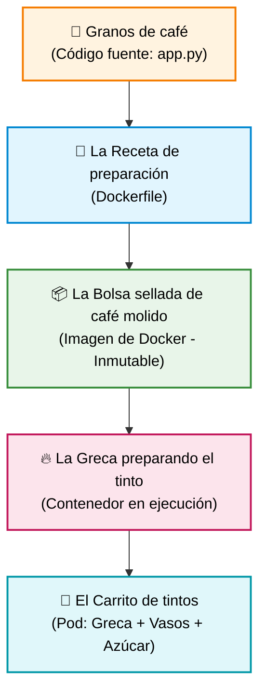
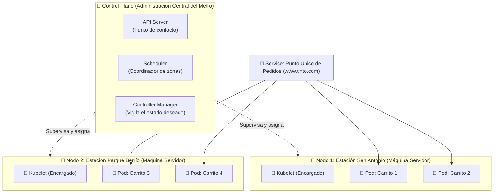

# ☕ De un Tinto Colombiano a Kubernetes
### Guion y Guía Visual para Explicar Contenedores, Pods, Nodos y Clústeres
**Cloud Native Medellín 🏔️☕**

> [!NOTE]
> Este documento sirve como **guion para instructores, speakers y estudiantes**. Explica toda la arquitectura de Kubernetes y Docker utilizando una analogía cotidiana que todos conocemos en Colombia: **el café, la greca y el carrito de tintos en una estación del Metro de Medellín**.

---

## 1. ☕ Empecemos por el Café (De Código a Pod)

### Paso 1. El código: los granos de café
Los granos son la materia prima. En nuestro ejemplo, el código fuente (`app.py`) contiene las instrucciones de nuestra aplicación: recibir un pedido, procesarlo y responder.

* **En palabras sencillas:** Sin los granos no tenemos café; sin el código no tenemos nuestra aplicación.

### Paso 2. El Dockerfile: la receta del café
La receta indica cómo preparar el café. De forma similar, el `Dockerfile` define cómo construir la imagen de nuestra aplicación: qué entorno necesita, qué dependencias instalar, qué archivos copiar y qué comando ejecutar.

* **En palabras sencillas:** La receta explica cómo preparar el producto; el `Dockerfile` explica cómo construir el paquete de la aplicación.

### Paso 3. La imagen de Docker: la bolsa de café sellada
La bolsa sellada contiene el café molido listo para preparar. La imagen de Docker contiene el código y las dependencias necesarias para ejecutar la aplicación. Una misma imagen se puede utilizar para crear muchos contenedores en diferentes máquinas.

* **En palabras sencillas:** Construimos el paquete una vez y podemos reutilizarlo en Medellín, Bogotá o Tokio, sin tener que reconstruir la aplicación desde cero en cada lugar.

### Paso 4. El contenedor: la greca preparando el tinto
La bolsa de café es el paquete; la greca encendida representa el proceso en ejecución. En tecnología, un contenedor es una instancia de una imagen que ejecuta la aplicación de forma aislada. Cuando el contenedor está funcionando, la aplicación puede recibir solicitudes y responderlas.

* **En palabras sencillas:** La imagen es lo que tenemos preparado; el contenedor es la aplicación funcionando y sirviendo.

### Paso 5. El Pod: el carrito de tintos
Imagina un carrito de tintos con su greca, vasos desechables y azúcar. El carrito representa el **Pod** y la greca representa el **contenedor**.

Un Pod es la unidad más pequeña que Kubernetes puede desplegar y administrar. Normalmente contiene un solo contenedor, aunque también puede contener contenedores secundarios (*sidecars*) que necesitan trabajar estrechamente relacionados.

* **En palabras sencillas:** El contenedor prepara el tinto; el Pod es la unidad que agrupa ese contenedor con los recursos que necesita para funcionar (red compartida, volúmenes y configuración).

---

## 2. 🚊 Ahora llevemos los Carritos a una Estación del Metro de Medellín

Ya tenemos nuestra aplicación funcionando en un carrito. Pero... **¿qué sucede cuando son las 7:00 a. m. y llegan cientos de personas a pedir tinto en hora pico?**

Aquí es donde aparecen los demás conceptos de Kubernetes:

* **Nodo (`Node`): la máquina que aloja los carritos:**  
  En Kubernetes, un nodo es una máquina física o virtual donde se ejecutan los Pods. Para la analogía, imagina una zona de trabajo o plataforma física de la estación con espacio y recursos para varios carritos.
* **Clúster (`Cluster`): toda la operación:**  
  Un clúster es el conjunto de todos los nodos coordinados por Kubernetes. Puedes imaginar varias zonas de trabajo que alojan los carritos y forman una sola operación coordinada.
* **Control Plane: la administración central:**  
  Es quien coordina la operación del clúster y mantiene el estado deseado. Kubernetes compara constantemente lo que *debería existir* con lo que *está funcionando realmente*, y actúa mediante sus controladores.

---

## 3. 🧩 ¿Cómo Funcionan los Demás Componentes?

| Componente de K8s | Analogía del Café | Explicación Técnica Sencilla |
| :--- | :--- | :--- |
| **`Deployment`** | **La orden de mantener 3 carritos disponibles** | Define y administra el estado deseado y las réplicas de la aplicación. |
| **`ReplicaSet`** | **El supervisor que procura mantener esos 3 carritos activos** | Garantiza que el número exacto de Pods esté siempre en ejecución. |
| **`Scheduler`** | **El coordinador que elige en qué estación poner cada carrito** | Decide en qué nodo ubicar un Pod según CPU/RAM libre y restricciones. |
| **`Kubelet`** | **El encargado de la estación** | Agente en cada nodo que recibe órdenes del Control Plane y cuida los Pods. |
| **`Service`** | **El aviso / punto estable donde se piden los tintos** | Ofrece una IP y DNS estable para balancear el tráfico hacia los Pods. |
| **`HPA` (Horizontal Pod Autoscaler)** | **Aumentar carritos automáticamente según la fila de clientes** | Escala el número de Pods según el consumo de CPU o solicitudes. |
| **`ConfigMap`** | **Las instrucciones de preparación del día (marca de agua, endulzante)** | Configuración no sensible desacoplada del contenedor. |
| **`Secret`** | **La clave de la caja fuerte o receta secreta del proveedor** | Gestión segura de datos sensibles (contraseñas, tokens de API). |

---

## 4. 🎬 El Caso Práctico: Son las 7:00 a. m. y Todos Quieren Tinto

Puedes contar esta historia durante el taller:

### 🟢 Escenario 1: Todo está tranquilo
Hay pocos pasajeros a las 5:30 a. m. y tenemos solo 2 carritos de tinto funcionando. En Kubernetes, tenemos 2 Pods ejecutando nuestra aplicación.

### 🟡 Escenario 2: Empieza la hora pico
A las 7:00 a. m. se llena la estación. Necesitamos más capacidad para atender los pedidos. Si configuramos un **HPA** y las métricas superan los umbrales establecidos, Kubernetes puede aumentar automáticamente las réplicas de 2 a 10 carritos, siempre que haya capacidad disponible en los nodos.

### 🔴 Escenario 3: Uno de los carritos deja de funcionar
Se riega el agua o se apaga la greca de un carrito. Si ese Pod está respaldado por un **Deployment**, Kubernetes detecta la falla y levanta un nuevo carrito de inmediato para recuperar el número deseado.

### ⚠️ Escenario 4: Una zona de trabajo deja de estar disponible
Se va la luz en una plataforma entera (falla de un servidor físico/nodo). Los Pods afectados son reprogramados por el **Scheduler** en otros nodos saludables que tengan recursos disponibles.

### 🚪 Escenario 5: Los clientes quieren saber dónde pedir
No queremos que los pasajeros tengan que perseguir los carritos ni memorizar qué carrito está en qué esquina. El **Service** ofrece una fila y caja única: los clientes piden allí y el sistema envía el pedido al carrito que esté desocupado.

> [!TIP]
> **La idea central:**  
> Kubernetes **no prepara el café**: administra y cuida a las aplicaciones que lo preparan, procura mantenerlas vivas y permite ajustar su capacidad según la demanda.

---

## 5. 🎯 Guion de Cierre para Decirlo en Voz Alta

> *"En Colombia, todos sabemos qué es pedir un tinto. Ahora imaginemos que queremos automatizar y escalar ese negocio.*
>
> *Primero tenemos el código, como los granos de café. Con el `Dockerfile` definimos la receta y construimos una imagen, que es como nuestra bolsa sellada de café molido. Cuando ejecutamos esa imagen, tenemos un contenedor: nuestra greca preparando el tinto.*
>
> *Ese contenedor funciona dentro de un Pod, que podemos imaginar como el carrito de tintos. Si necesitamos atender más personas, creamos más Pods. Esos Pods se ejecutan sobre nodos, que forman parte de un clúster.*
>
> *Kubernetes coordina todo: decide dónde ejecutar los Pods, procura mantener la cantidad que necesitamos y nos ayuda a reaccionar cuando aumenta la demanda o algo falla.*
>
> *Así como una red de carritos debe estar preparada para atender a toda una estación del Metro en hora pico, nuestras aplicaciones deben estar preparadas para atender a miles de usuarios sin depender de un solo servidor."*

---

## ❓ Pregunta para Involucrar a los Participantes

> **"Si mañana llegan diez veces más personas a pedir tinto, ¿qué cambiarían primero: la cantidad de carritos, la receta o la bolsa de café?"**

👉 **Respuesta esperada:** Aumentar la cantidad de carritos (**escalar las réplicas de los Pods**). No necesitamos reconstruir la imagen de la aplicación ni reescribir la receta solo porque haya más clientes.

---

> [!NOTE]
> **Nota técnica:**  
> Las analogías ayudan a comprender los conceptos, pero no son equivalencias literales:
> * Un **contenedor** es una instancia en ejecución de una imagen aislada con cgroups y namespaces.
> * Un **Pod** puede contener uno o más contenedores que comparten IP y volúmenes (`localhost`).
> * Un **nodo** es una máquina física o virtual con `kubelet` y un runtime de contenedores (como `containerd`).
> * Un **clúster** está formado por el Control Plane (cerebro) y los nodos de trabajo que ejecutan las aplicaciones.
