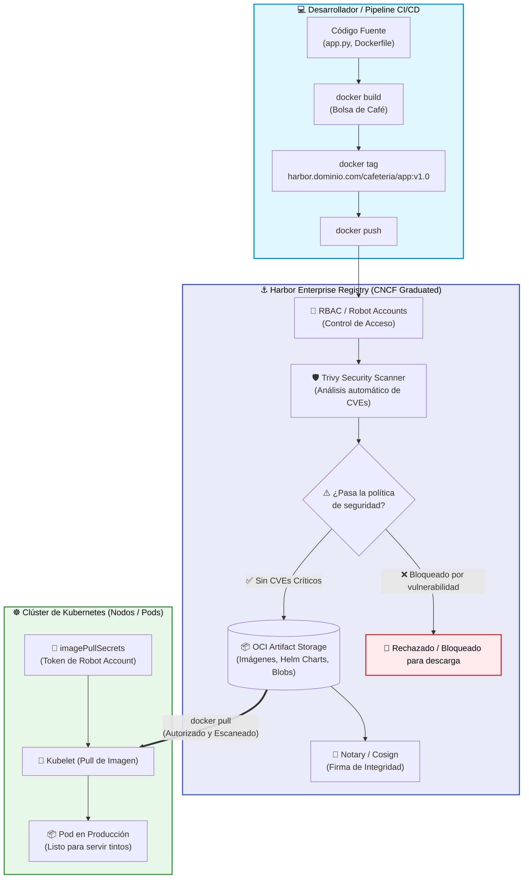
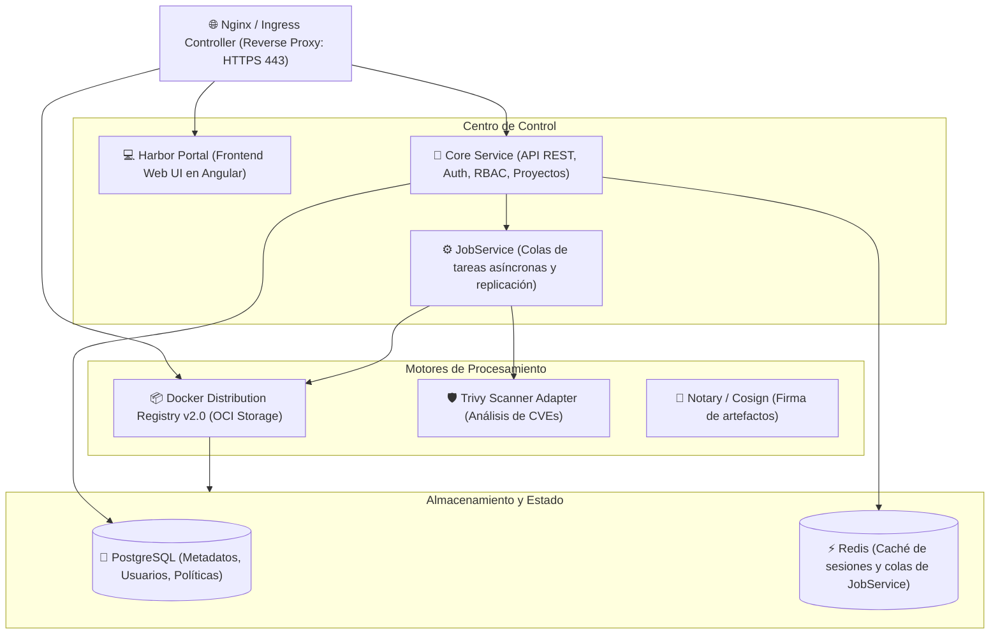
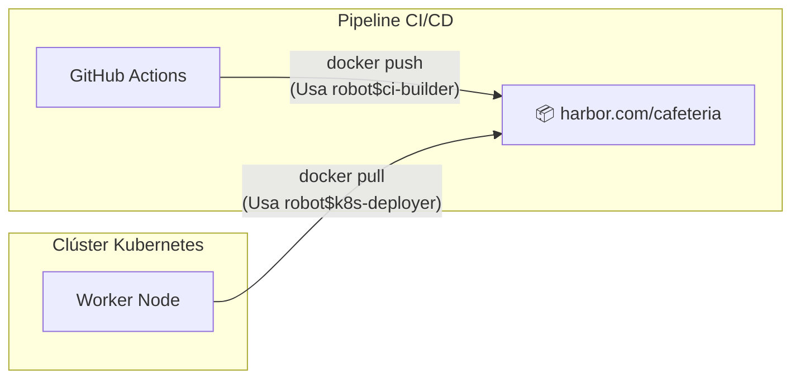

# ⚓ Guía Empresarial de Registro de Contenedores con Harbor

Bienvenido a la guía oficial sobre **Harbor Enterprise Container Registry** del workshop *"De Cero a Capitán en Kubernetes"*, impulsado por la comunidad **Cloud Native Medellín** 🏔️☕.

---

## ☕ La Analogía Paisa: La Bodega Central de Café de Exportación

En los ejemplos anteriores aprendimos a empacar el café en bolsas selladas e inmutables (las imágenes de Docker: `mi-web-estatica:v1.0`, `mi-api-cnm:v1.0`, etc.). 

Pero surge una pregunta clave:
> *¿Dónde almacenamos, custodiamos y catalogamos miles de bolsas de café para que todos los carritos y estaciones del Metro puedan abastecerse de forma segura, privada y con control de calidad?*

* **Docker Hub público:** Es como dejar tus bolsas de café en un puesto ambulante en el Parque Berrío a la vista de todo el mundo. Cualquiera puede verlas, tomarlas o dejar imitaciones. Además, hay límite de descargas gratuitas (rate limits).
* **Harbor Enterprise Registry:** Es la **bodega central blindada de la Federación de Cafeteros**. 
  * Tiene celador y carnet de entrada (**RBAC y Autenticación**).
  * Cuenta con inspectores de salubridad que pasan rayos X a cada bolsa antes de dejarla entrar (**Escáner de vulnerabilidades con Trivy**). Si una bolsa tiene bichos o plagas (CVEs críticos), la bodega prohíbe despacharla al público (**Políticas de Prevención**).
  * Tiene sellos de origen y estampillas de autenticidad (**Firma digital con Cosign**).
  * Emite permisos especiales temporales para los camiones de reparto sin tener que prestar la llave de la gerencia (**Robot Accounts**).



---

## 🧭 ¿Qué es Harbor y por qué es el estándar en Cloud Native?

[**Harbor**](https://goharbor.io/) es un registro de artefactos de código abierto de grado empresarial desarrollado originalmente por VMware y actualmente un **proyecto graduado de la CNCF** (Cloud Native Computing Foundation), al mismo nivel de madurez que Kubernetes, Prometheus y Envoy.

### Comparativa: ¿Por qué no usar simplemente Docker Hub?

| Característica | Docker Hub (Gratuito) | GitHub Packages (GHCR) | Registros de Nube (ECR/ACR/GAR) | ⚓ Harbor Enterprise (Self-Hosted) |
| :--- | :---: | :---: | :---: | :---: |
| **Alojamiento** | Nube pública | Nube pública | Nube pública del proveedor | **Tu propia infraestructura, nube o On-Premise** |
| **Costos por almacenamiento/tráfico** | Límites y cobro por asientos | Cobro por GB de ancho de banda | Cobro por GB almacenado y egress | **100% Open Source y gratuito** |
| **Entornos aislados (Air-Gapped)** | ❌ No disponible | ❌ No disponible | ❌ Complejo / Costoso | **✅ Diseñado para redes privadas y bancos** |
| **Escáner de seguridad integrado** | Limitado | Básico (Dependabot) | Varía por proveedor | **✅ Trivy integrado automático con políticas** |
| **Bloqueo preventivo de despliegues** | ❌ No | ❌ No | ⚠️ Requiere servicios extra | **✅ Bloquea el `pull` si supera umbral de CVEs** |
| **Cuentas Robot con expiración** | ❌ Solo tokens personales | ❌ PAT de usuario | ⚠️ IAM Policies complejas | **✅ Cuentas Robot dedicadas por proyecto** |
| **Replicación entre centros de datos** | ❌ No | ❌ No | ⚠️ Solo dentro del mismo proveedor | **✅ Replicación bidireccional multi-registro** |
| **Firma y procedencia de imágenes** | ⚠️ Parcial | ⚠️ Parcial | ⚠️ Varía | **✅ Cosign y Notary nativos** |

---

## 🏛️ Arquitectura Interna de Harbor

Harbor no es un solo contenedor; es un conjunto de microservicios orquestados que resuelven cada necesidad del ciclo de vida de los artefactos:



1. **Proxy (Nginx):** Punto de entrada único que gestiona certificados SSL/TLS y enruta el tráfico web (UI), las llamadas a la API REST y las descargas de imágenes de Docker (`/v2/`).
2. **Harbor Portal & Core:** Interfaz gráfica moderna y API REST que gestiona proyectos, usuarios, permisos, cuotas y auditorías.
3. **Docker Distribution Registry (v2.0):** El motor que almacena físicamente las capas OCI de las imágenes y gestiona los manifiestos.
4. **Trivy Scanner:** El motor de seguridad que analiza las imágenes apenas son subidas (`push`) y genera reportes detallados de vulnerabilidades.
5. **JobService:** Planificador en segundo plano para tareas pesadas: escaneo de vulnerabilidades, recolección de basura (*Garbage Collection*) y replicación hacia otros registros.
6. **PostgreSQL & Redis:** Persistencia de metadatos, control de acceso y colas de mensajería rápida.

---

## 🚀 Opciones de Despliegue de Harbor

### Opción 1: Despliegue Rápido con Docker Compose (Para Pruebas y Laboratorios)

Es la forma más sencilla de tener una instancia completa de Harbor corriendo en un servidor Linux o en tu máquina local:

1. **Descargar el instalador oficial:**
   ```bash
   # Descargar la versión más reciente (ej. v2.10.x)
   curl -s https://api.github.com/repos/goharbor/harbor/releases/latest \
     | grep browser_download_url | grep 'offline-installer' | cut -d '"' -f 4 | wget -qi -
   
   tar xzvf harbor-offline-installer-*.tgz
   cd harbor
   ```

2. **Configurar `harbor.yml`:**
   ```bash
   cp harbor.yml.tmpl harbor.yml
   ```
   Edita los siguientes campos en `harbor.yml`:
   ```yaml
   hostname: harbor.local.net          # O la IP de tu servidor
   http:
     port: 8080                       # Puerto HTTP
   # Si estás en un laboratorio de pruebas sin SSL, comenta la sección https:
   # https:
   #   port: 8443
   #   certificate: /path/to/cert
   #   private_key: /path/to/key
   harbor_admin_password: HarborAdminPassword123!
   ```

3. **Ejecutar el script de instalación con Trivy:**
   ```bash
   ./install.sh --with-trivy
   ```

4. **Acceder a la interfaz:**  
   Ingresa a `http://localhost:8080` (Usuario: `admin` | Contraseña: la que configuraste).

---

### Opción 2: Despliegue en Producción en Kubernetes (Vía Helm Chart)

Para entornos empresariales de alta disponibilidad, Harbor se instala directamente dentro del clúster de Kubernetes usando Helm:

```bash
# 1. Agregar el repositorio de Helm de Harbor
helm repo add harbor https://helm.goharbor.io
helm repo update

# 2. Instalar Harbor con persistencia y escáner Trivy
helm install mi-harbor harbor/harbor \
  --namespace harbor --create-namespace \
  --set expose.type=ingress \
  --set expose.ingress.hosts.core=harbor.mi-empresa.com \
  --set externalURL=https://harbor.mi-empresa.com \
  --set trivy.enabled=true \
  --set persistence.persistentVolumeClaim.registry.size=100Gi
```

---

## 🔐 Pilares de Seguridad en Harbor

### 1. Cuentas Robot (`Robot Accounts`) — Adiós a las contraseñas personales en CI/CD

Nunca uses tu usuario personal ni la contraseña de administrador para pipelines de GitHub Actions, GitLab CI o clústeres de Kubernetes. 

Harbor permite crear **Cuentas Robot**:
* Tienen un nombre estandarizado (ej: `robot$github-actions` o `robot$k8s-puller`).
* Tienen permisos mínimos restringidos a un solo proyecto (ejemplo: solo lectura `pull`, o solo escritura `push`).
* Generan un token secreto seguro y pueden configurarse con **fecha de expiración**.
* Si la cuenta se ve comprometida, se revoca con un solo clic sin afectar a los usuarios humanos.



---

### 2. Escaneo Automático de Vulnerabilidades con Trivy

Harbor viene preintegrado con Trivy. En cada proyecto puedes activar:
* **Scan on Push:** Cada vez que un desarrollador o pipeline sube una imagen, Harbor lanza inmediatamente un escaneo en segundo plano.
* **Scan Schedule:** Escaneo programado diario o semanal para detectar vulnerabilidades recién descubiertas en imágenes viejas.

---

### 3. Política de Prevención de Despliegues (*Vulnerability Prevention*)

Esta es una de las funciones más potentes de Harbor. Puedes configurar una regla en el proyecto:
> ⛔ *"Bloquear la descarga (`docker pull`) si la imagen contiene vulnerabilidades de severidad IGUAL o SUPERIOR a: **CRITICAL** o **HIGH**"*.

Si una imagen vulnerable intenta ser descargada por Kubernetes o por un servidor, Harbor **rechaza la petición de pull** y arroja un error:
```text
Error response from daemon: unknown: The image is vulnerable and cannot be pulled according to the project policy.
```
¡Esto evita automáticamente que código con fallos graves de seguridad llegue a producción!

---

### 4. Inmutabilidad de Tags y Recolección de Basura (*Garbage Collection*)

* **Tag Immutability:** En producción nunca permitas que alguien sobrescriba `v1.0` con un código nuevo. Harbor permite bloquear la sobrescritura de tags específicos (ej. `v*` o `release-*`).
* **Retention Rules:** Reglas para borrar automáticamente imágenes viejas (ej: *"Conservar solo las últimas 10 versiones"* o *"Eliminar imágenes sin pulls en los últimos 30 días"*).
* **Garbage Collection (GC):** Libera físicamente el espacio en disco de los bloques de datos no referenciados.

---

## 💻 El Flujo Completo desde la Terminal (Docker CLI)

A continuación se muestra el ciclo de vida real para trabajar con Harbor desde tu línea de comandos:

### Paso 1: Autenticación en Harbor

```bash
docker login <host-harbor> -u <usuario-o-robot> -p <contraseña-o-token>
```
*Ejemplo:*
```bash
docker login harbor.cloudnative.local:8080 -u "robot$ci-tinto" -p "r.secret-token-xyz..."
```
> ✅ **Mensaje:** `Login Succeeded`

---

### Paso 2: La Nomenclatura Estándar OCI en Docker

Para que el cliente Docker sepa a qué registro remoto debe enviar la imagen, la URL del servidor y el proyecto deben estar prefijados en el tag:

$$\text{Nomenclatura:} \quad \mathbf{\langle servidor\text{-}harbor\rangle} / \mathbf{\langle nombre\text{-}proyecto\rangle} / \mathbf{\langle nombre\text{-}imagen\rangle} : \mathbf{\langle tag\rangle}$$

```bash
# Formato general de etiquetado:
docker tag mi-aplicacion:v1.0 harbor.empresa.com/mi-proyecto/mi-aplicacion:v1.0
```

---

### Paso 3: Subida y Descarga (`docker push` / `docker pull`)

```bash
# Subir la imagen al registro remoto:
docker push harbor.empresa.com/mi-proyecto/mi-aplicacion:v1.0

# Descargar la imagen en cualquier servidor autorizado:
docker pull harbor.empresa.com/mi-proyecto/mi-aplicacion:v1.0
```

> 🧪 **¿Quieres practicar el flujo completo?**  
> En el [**Laboratorio 05: Publicación con Harbor**](../semana-00-fundamentos-docker/1.ejemplos/05-registro-imagenes-harbor/README.md) etiquetarás y publicarás las imágenes de los laboratorios 01 a 04 en un registro local con interfaz web.

---

## ☸️ Vista Previa: ¿Cómo se usará en Kubernetes? (`imagePullSecrets`)

> [!NOTE]
> ⚠️ **Nota pedagógica para estudiantes de la Semana 0 (Fundamentos de Docker):**  
> Si estás cursando el módulo inicial de Docker, **no necesitas ejecutar estos comandos todavía**. En la **Semana 1** aprenderás qué es un Pod, qué es un Secret y cómo usar `kubectl`. Esta sección se incluye aquí como una vista previa conceptual para que entiendas la razón de ser de Harbor en el ecosistema Kubernetes.

Cuando despleguemos en Kubernetes a partir de la Semana 1, los nodos del clúster necesitarán credenciales para descargar imágenes de un registro privado de Harbor. Esto se realiza de la siguiente manera:

### 1. Crear el `Secret` de Docker Registry en Kubernetes

Ejecuta con `kubectl` usando las credenciales de la Cuenta Robot de Harbor:

```bash
kubectl create secret docker-registry harbor-credenciales \
  --docker-server=harbor.local:8080 \
  --docker-username="robot$k8s-deployer" \
  --docker-password="tu-token-de-robot" \
  --docker-email="ops@cloudnativemedellin.org" \
  --namespace=default
```

---

### 2. Referenciar el Secret en el Manifiesto del Pod (`pod.yaml`)

En la especificación del Pod (`spec`), agregamos la directiva **`imagePullSecrets`**:

```yaml
apiVersion: v1
kind: Pod
metadata:
  name: api-tinto-desde-harbor
  labels:
    app: api-tinto
spec:
  # 🔑 Vinculación con el Secret creado en el paso anterior:
  imagePullSecrets:
    - name: harbor-credenciales
  
  containers:
    - name: app
      image: harbor.local:8080/cafeteria/mi-api-cnm:v1.0
      ports:
        - containerPort: 8080
          name: http
      resources:
        limits:
          memory: "128Mi"
          cpu: "200m"
        requests:
          memory: "64Mi"
          cpu: "50m"
```

Al aplicar este manifiesto (`kubectl apply -f pod.yaml`), el Kubelet del nodo lee el secreto, se autentica contra Harbor, descarga la imagen y levanta el Pod sin fallos de autenticación (`ErrImagePull` o `ImagePullBackOff`).

---

## 📚 Índice de Guías y Recursos Complementarios

| Documento | Descripción | Enlace |
| :--- | :--- | :--- |
| **☕ De un Tinto Colombiano a Kubernetes** | Guía narrativa para entender Pods, Services, Deployments y la hora pico con la analogía del Metro de Medellín. | [Ver Guía del Tinto](./de-un-tinto-a-kubernetes.md) |
| **🛡️ Guía Completa de Seguridad con Trivy** | Cómo instalar y ejecutar Trivy por CLI, detectar CVEs, auditar Dockerfiles y generar reportes HTML. | [Ver Guía de Trivy](./guia-trivy-seguridad.md) |
| **🤖 Guía de IA Local con Ollama** | Ejecución de LLMs locales en Docker en CPU/GPU sin costos por token y con privacidad total. | [Ver Guía de Ollama](./guia-ollama-ia-local.md) |
| **🧪 Laboratorio Práctico 05 (Harbor)** | Ejercicio paso a paso para etiquetar, publicar y validar imágenes en Harbor. | [Ver Ejemplo 05](../semana-00-fundamentos-docker/1.ejemplos/05-registro-imagenes-harbor/README.md) |

---

*Desarrollado con dedicación para la comunidad Cloud Native Medellín 🏔️☕ — ¡De Cero a Capitán en Kubernetes!*
