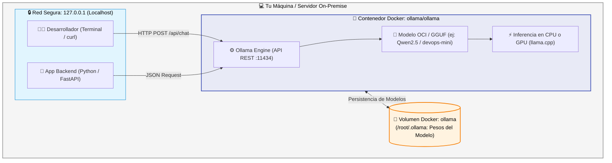

# 🤖 Guía Completa de IA Local y Modelos de Lenguaje en Docker con Ollama

Bienvenido a la guía oficial sobre **ejecución de Inteligencia Artificial local con Ollama en contenedores Docker**, parte del workshop *"De Cero a Capitán en Kubernetes"*, impulsado por la comunidad **Cloud Native Medellín** 🏔️☕.

---

## ☕ La Analogía Paisa: La Greca Inteligente y el Barista Aprendiz

En los laboratorios anteriores empaquetamos páginas web, APIs y bases de datos. Pero en la era Cloud Native moderna, muchas aplicaciones integran capacidades de **Inteligencia Artificial**.

Imagina un carrito de café en el Metro de Medellín:
* **APIs de IA en la nube (OpenAI, Claude, Gemini):** Es como pedir asesoría a un barista gourmet en Milán por llamada satelital. Es brillante, pero cuesta dinero por cada segundo de llamada (costo por token), necesitas Internet 100% estable y estás compartiendo los datos de tus clientes con un tercero fuera del país.
* **Ollama en Contenedor Local:** Es contratar a un **barista aprendiz paisa** sentado dentro de tu propio carrito.
  * No necesita conexión a Internet una vez descargado (**funciona 100% offline y en redes privadas**).
  * **Cero costo por token:** Pregúntale 1 vez o 10.000 veces al día; la cuenta siempre es cero.
  * **Privacidad total de datos:** Tus logs, configuraciones de Kubernetes y consultas nunca salen de tu máquina física.
  * Con el uniforme y manual adecuado (**`Modelfile`**), lo especializas en tareas concretas (asistente DevOps, generador de YAML, etc.).



---

## 🧭 ¿Qué es Ollama y por qué ejecutarlo en Docker?

[**Ollama**](https://ollama.com) es una plataforma de código abierto construida sobre `llama.cpp` que simplifica drásticamente el empaquetado, descarga y ejecución de **Modelos de Lenguaje Grande (LLMs)** en entornos locales y servidores.

### Comparativa: Ollama en Docker vs. APIs en la Nube

| Criterio | ☁️ APIs en la Nube (OpenAI / Claude / Gemini) | 🐳 Ollama en Docker (Local / Self-Hosted) ⭐ |
| :--- | :--- | :--- |
| **Privacidad de Datos** | Los prompts viajan por Internet a servidores externos. | **100% privada:** Ningún byte sale de tu servidor o red local. |
| **Costo por Uso** | Pago por consumo recurrente (Tokens de entrada y salida). | **$0 / mes:** Costo cero de inferencia ilimitada. |
| **Dependencia de Conexión** | Requiere conexión a Internet constante y de baja latencia. | **Funciona 100% offline / Air-gapped.** |
| **Instalación y Dependencias** | Solo SDK / HTTP client. | **Cero dependencias:** No requiere Python, CUDA ni drivers en el host. |
| **Gobernanza y Cumplimiento** | Depende de las políticas del proveedor en EE.UU. | **Total control:** Cumple con regulaciones bancarias y de salud. |

---

## 🛠️ Ejecución con Docker: Opciones y Comandos

### Modo 1: En CPU (Para cualquier computador portátil o servidor estándar)

No necesitas tarjeta gráfica dedicada (GPU) ni drivers propietarios de NVIDIA:

```bash
# 1. Crear volumen persistente para los modelos
docker volume create ollama

# 2. Iniciar el contenedor con límites de recursos seguros
docker run -d \
  --name ollama \
  --restart unless-stopped \
  --memory=2g \
  --cpus=4 \
  -p 127.0.0.1:11434:11434 \
  -v ollama:/root/.ollama \
  ollama/ollama
```

### Modo 2: Aceleración por GPU (NVIDIA en Linux o WSL2)

Si dispones de una tarjeta NVIDIA con el [NVIDIA Container Toolkit](https://docs.nvidia.com/datacenter/cloud-native/container-toolkit/latest/install-guide.html) instalado:

```bash
docker run -d \
  --name ollama \
  --gpus=all \
  --restart unless-stopped \
  -p 127.0.0.1:11434:11434 \
  -v ollama:/root/.ollama \
  ollama/ollama
```

---

## 📄 El `Modelfile`: La "Receta" de la IA

Así como un `Dockerfile` define cómo construir una imagen de contenedor, un **`Modelfile`** define cómo construir un modelo de lenguaje derivado con instrucciones y parámetros específicos:

```dockerfile
# 1. Modelo base descargado de ollama.com/library
FROM qwen2.5:0.5b

# 2. Tamaño de la ventana de contexto (tokens que recuerda la conversación)
PARAMETER num_ctx 1024

# 3. Límite máximo de tokens por respuesta
PARAMETER num_predict 256

# 4. Temperatura: 0.0 a 1.0 (Valores bajos = respuestas precisas y deterministas)
PARAMETER temperature 0.2

# 5. Instrucciones de sistema (Prompt del Sistema / Rol)
SYSTEM """
Eres un asistente DevOps senior especializado en Linux, Docker y Kubernetes.
Responde en español de forma concisa.
Prioriza comandos reproducibles y seguros.
Advierte antes de sugerir comandos destructivos como 'rm -rf' o 'kubectl delete'.
"""
```

### Cómo compilar el modelo personalizado:
```bash
docker exec -i ollama ollama create devops-mini -f /dev/stdin < Modelfile
```

---

## 📡 Referencia de la API REST de Ollama

Ollama expone un servidor HTTP completo en el puerto `11434`:

### 1. Endpoint `/api/chat` (Conversación tipo OpenAI)
```bash
curl http://127.0.0.1:11434/api/chat \
  -H 'Content-Type: application/json' \
  -d '{
    "model": "devops-mini",
    "messages": [
      {
        "role": "user",
        "content": "¿Cómo reviso los logs de un contenedor detenido?"
      }
    ],
    "stream": false,
    "options": {
      "temperature": 0.2
    }
  }'
```

### 2. Endpoint `/api/tags` (Listar modelos instalados)
```bash
curl -s http://127.0.0.1:11434/api/tags | jq
```

### 3. Endpoint `/api/version` (Comprobar estado del servidor)
```bash
curl -s http://127.0.0.1:11434/api/version
```

---

## 🔐 Pilares de Seguridad al Correr IA en Contenedores

| Regla de Oro | ¿Por qué es obligatoria? |
| :--- | :--- |
| **1. Publicar solo en `127.0.0.1`** | La API de Ollama **no tiene autenticación por defecto**. Si publicas `-p 11434:11434` (en `0.0.0.0`), cualquiera en tu red o en Internet podrá hacer llamadas a tu máquina y agotar tu CPU y RAM. |
| **2. NUNCA montar `/var/run/docker.sock`** | Nunca le des acceso al socket de Docker al contenedor de un LLM. Si el modelo genera o ejecuta código automáticamente, podría tomar control absoluto de tu sistema anfitrión. |
| **3. Limitar siempre memoria y CPUs** | Los LLMs son ávidos de recursos. Usar `--memory=1400m` y `--cpus=3` evita que una inferencia compleja congele el computador (*Kernel Panic* o *OOM*). |
| **4. Validación humana obligatoria (*Human-in-the-loop*)** | Los modelos de lenguaje pueden "alucinar" parámetros o flags que no existen. **Nunca conectes la salida de un LLM directamente a un `eval` de bash o `kubectl apply` sin revisión humana previa**. |

---

## 🎯 Modelos Recomendados por Capacidad de Hardware

| Modelo | Parámetros | Tamaño Descarga | RAM Recomendada | Caso de Uso Ideal |
| :--- | :---: | :---: | :---: | :--- |
| **Qwen2.5** | `0.5b` | ~400 MB | 2 GB | Pruebas rápidas en laptops, bots sencillos, bajo consumo. |
| **Qwen2.5** | `1.5b` | ~1.0 GB | 4 GB | Asistente de terminal ligero, respuestas más coherentes. |
| **Llama 3.2** | `1b` / `3b` | ~1.3 GB - 2.0 GB | 4 GB - 6 GB | Razonamiento general y redacción técnica en español. |
| **Qwen2.5-Coder** | `7b` | ~4.7 GB | 12 GB - 16 GB | Generación profesional de YAMLs, Dockerfiles y scripts Bash. |

---

## 📚 Enlaces y Recursos Oficiales

* 🌐 Sitio Web Oficial: [ollama.com](https://ollama.com)
* 📖 Documentación de Ollama: [docs.ollama.com](https://docs.ollama.com)
* 🐳 Ollama en Docker: [docs.ollama.com/docker](https://docs.ollama.com/docker)
* 📄 Referencia de Modelfile: [docs.ollama.com/modelfile](https://docs.ollama.com/modelfile)
* 🔌 Referencia de la API REST: [docs.ollama.com/api](https://docs.ollama.com/api)
* 📦 Catálogo de Modelos: [ollama.com/library](https://ollama.com/library)
* 🧪 Laboratorio Práctico en este repo: [Ver Ejemplo 06](../semana-00-fundamentos-docker/1.ejemplos/06-ia-local-ollama/README.md)

---

*Desarrollado para la comunidad Cloud Native Medellín 🏔️☕ — ¡De Cero a Capitán en Kubernetes!*
