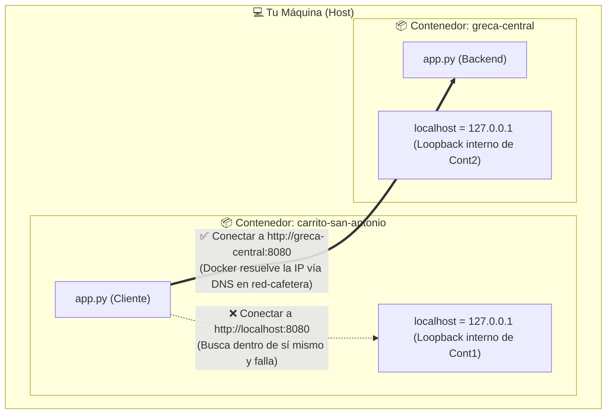

# 🌐 Ejemplo 03: Redes en Docker y Comunicación entre Contenedores

En este laboratorio aprenderás cómo conectar dos o más contenedores entre sí usando **redes bridge personalizadas** y cómo funciona el **DNS interno de Docker**.

---

## ☕ La Analogía Paisa: El Walkie-Talkie del Metro

Imagina dos carritos de tinto en la estación San Antonio:
* El carrito de la plataforma norte (`carrito-san-antonio`) se quedó sin café molido.
* En el sótano está la greca central de reserva (`greca-central`).

Si el vendedor grita por telepatía o le habla a su propio bolsillo (`localhost`), la greca central jamás lo escuchará.  
Para comunicarse necesitan:
1. **Sintonizar la misma frecuencia de radio:** La red bridge de Docker (`docker network create red-cafetera`).
2. **Llamarse por su indicativo:** El nombre del contenedor (`http://greca-central:8080`).  
Docker actúa como la central de telecomunicaciones: cuando pides `greca-central`, el DNS interno de Docker traduce ese nombre a la IP privada (`172.18.0.2`) al instante.

---

## 🧠 El Gran Error de Principiante: ¿Por qué falla `localhost`?



Cada contenedor tiene su propio **Network Namespace** (su propia interfaz loopback `127.0.0.1`, su propia tabla de enrutamiento y sus propias IPs). `localhost` dentro de un contenedor **SOLO** se refiere a sí mismo.

---

## 🚀 Práctica Paso a Paso

### 1. Crear una red bridge personalizada
Nunca uses la red bridge por defecto (`bridge`) para microservicios porque **no tiene resolución DNS automática por nombre**. Siempre crea tu propia red:

```bash
docker network create red-cafetera
```

Verifica que la red existe:
```bash
docker network ls
```

---

### 2. Construir las imágenes
Desde la raíz del repositorio:

```bash
# Backend (Greca Central)
docker build -t greca-backend:v1.0 semana-00-fundamentos-docker/1.ejemplos/03-redes-comunicacion-contenedores/backend-api

# Cliente (Carrito San Antonio)
docker build -t carrito-cliente:v1.0 semana-00-fundamentos-docker/1.ejemplos/03-redes-comunicacion-contenedores/cliente-app
```

---

### 3. Iniciar el Backend (Greca Central)
Inicia el backend conectándolo a la red `red-cafetera`. **Nota:** ¡No necesitamos publicar su puerto con `-p` en el host si solo queremos que otros contenedores lo consuman internamente!

```bash
docker run -d \
  --name greca-central \
  --network red-cafetera \
  greca-backend:v1.0
```

---

### 4. Iniciar el Cliente (Carrito)
Inicia el cliente en la misma red y expón el puerto `8081` hacia tu máquina para interactuar:

```bash
docker run -d \
  --name carrito-san-antonio \
  --network red-cafetera \
  -p 8081:8081 \
  -e BACKEND_HOST="greca-central" \
  carrito-cliente:v1.0
```

---

### 5. Probar la comunicación
Prueba desde tu navegador o terminal:

* **En tu navegador:** Abre **[http://localhost:8081](http://localhost:8081)** para ver el diagrama de flujo y la respuesta obtenida del backend vía DNS.
* **En terminal con curl:**
  ```bash
  curl http://localhost:8081
  ```

Verás una respuesta confirmando la resolución DNS interna:
```json
{
  "cliente": "carrito-san-antonio",
  "ip_cliente": "172.18.0.3",
  "host_consultado": "greca-central",
  "ip_resuelta_por_dns_docker": "172.18.0.2",
  "respuesta_backend": {
    "origen": "greca-central",
    "mensaje": "☕ ¡Tinto despachado desde la Greca Central!",
    "tintos_restantes_inventario": 99,
    "red_docker": "Conexión exitosa mediante DNS interno de Docker"
  }
}
```

---

### 6. Inspeccionar la red con `docker network inspect`
Docker te permite ver todos los contenedores conectados a la red y sus direcciones IP privadas:

```bash
docker network inspect red-cafetera
```

Observa la sección `Containers`: verás a `greca-central` y a `carrito-san-antonio` compartiendo el mismo segmento de red (ej. `172.18.0.0/16`).

---

### 7. Limpieza
Al terminar la práctica:

```bash
docker rm -f greca-central carrito-san-antonio
docker network rm red-cafetera
```

---

## 🌉 El Puente a Kubernetes: ¿Cómo se traduce esto?

| En Docker | En Kubernetes |
| :--- | :--- |
| `docker network create` | **CNI Plugin** (Calico, Cilium, Flannel, Kindnet) que crea la red plana de Pods. |
| `--name greca-central` | **Service de Kubernetes (`ClusterIP`)** con un nombre DNS estable. |
| DNS interno de Docker (`127.0.0.11`) | **CoreDNS (`kube-dns`)**: Resuelve nombres como `greca-central.default.svc.cluster.local`. |
| Conectar contenedores por nombre | Los Pods consumen Services usando el nombre del Service directamente en su código. |
