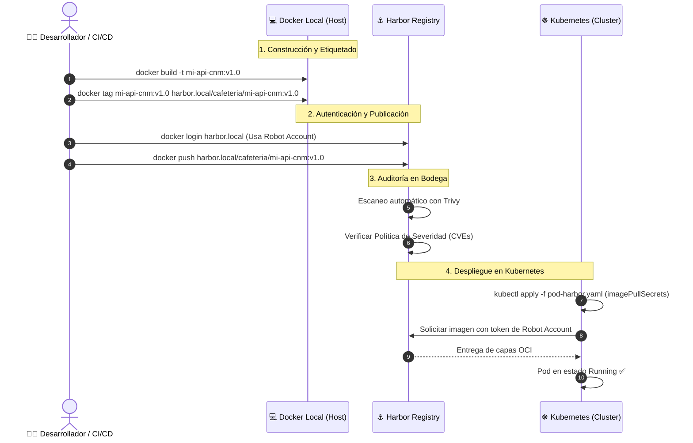

# ⚓ Ejemplo 05: Registro de Imágenes con Harbor (Tag, Push, Pull y Kubernetes)

En este laboratorio aprenderás cómo almacenar, versionar, escanear y distribuir de forma segura las imágenes que construiste en los ejemplos anteriores (`01`, `02`, `03` y `04`) utilizando **Harbor**, el registro de contenedores empresarial de código abierto graduado de la **CNCF**.

Además, aprenderás a generar **Cuentas Robot**, configurar políticas de escaneo automático con **Trivy** y conectar tu clúster de **Kubernetes** a un registro privado mediante **`imagePullSecrets`**.

---

## ☕ La Analogía Paisa: La Bodega Central de Café de Exportación

* En los laboratorios anteriores aprendiste a tostar el café (`Dockerfile`) y a empacarlo en bolsas selladas al vacío (`docker build`).
* Pero si dejas tus bolsas tiradas en la acera de la estación del Metro o en un puesto informal en la calle (**Docker Hub público** sin control), cualquiera puede adulterarlas, robarlas o puedes quedarte sin stock si te aplican límites de descarga.
* **Harbor es la Bodega Central Blindada de la Federación Cafetera:**
  * **Portería con carnet (`docker login`):** Nadie entra sin autorización ni credenciales.
  * **Sección de lotes (`Proyectos` en Harbor):** Área exclusiva para tu equipo (`cafeteria` o `cloud-native-medellin`).
  * **Filtro de sanidad (Trivy Integrado):** Antes de colocar una bolsa en la estantería, un escáner revisa que no tenga plagas ni químicos dañinos (CVEs). Si no pasa la prueba, la bodega prohíbe despacharla al público (**Vulnerability Prevention Policy**).
  * **Pase de conductor para camiones de reparto (`Robot Accounts`):** Un carnet temporal de solo lectura o solo escritura para que los camiones de Kubernetes y de los pipelines de CI/CD recojan las bolsas sin darles la llave maestra de la oficina del gerente.

---

## 🏗️ Flujo de Trabajo: Del Código a Kubernetes pasando por Harbor



---

## 📄 Estructura del Ejemplo

```text
05-registro-imagenes-harbor/
├── docker-compose.yml        # Entorno local de pruebas (Registry + Web UI)
├── pod-harbor-ejemplo.yaml   # Manifiesto de Pod en K8s con imagePullSecrets
└── README.md                 # Esta guía paso a paso
```

---

## 🚀 Flujo Práctico Paso a Paso

### 1. Entorno de Harbor para Practicar

Tienes dos maneras de realizar esta práctica:

* **Opción A (Instancia Empresarial / Servidor Harbor):**  
  Si tu empresa, comunidad o laboratorio ya cuenta con una instancia de Harbor (ej: `https://harbor.mi-empresa.com` o la IP de tu servidor), usa esa URL y tus credenciales asignadas.
* **Opción B (Laboratorio Local Rápido):**  
  Si estás en tu propia máquina y deseas simular el registro con interfaz web de inmediato, levanta el registro local incluido en esta carpeta:
  ```bash
  docker compose -f semana-00-fundamentos-docker/1.ejemplos/05-registro-imagenes-harbor/docker-compose.yml up -d
  ```
  Esto levantará un registro OCI en el puerto `5001` y una interfaz gráfica web en **[http://localhost:8082](http://localhost:8082)**.

---

### 2. Autenticación en el Registro (`docker login`)

Para interactuar con un registro remoto o protegido, debes iniciar sesión desde tu terminal:

```bash
# Formato:
docker login <host-del-registro> -u <usuario> -p <contraseña>

# Ejemplo con Harbor empresarial:
docker login harbor.cloudnative.local:8080 -u "admin" -p "Harbor12345"

# O usando el token de una Cuenta Robot (Buena práctica de seguridad):
docker login harbor.cloudnative.local:8080 -u "robot$k8s-deployer" -p "tu-token-secreto"
```

> ✅ **Resultado exitoso:**
> ```text
> WARNING! Using --password via the CLI is insecure. Use --password-stdin.
> Login Succeeded
> ```

---

### 3. Crear el Proyecto en Harbor

En la interfaz web de Harbor:
1. Haz clic en **"+ New Project"** (Nuevo Proyecto).
2. Nómbralo: `cafeteria` (o el nombre de tu equipo/app).
3. Selecciona el nivel de acceso:
   * **Private (Privado):** Recomendado para producción. Solo usuarios y robots autenticados pueden descargar (`pull`) o subir (`push`).
   * **Public (Público):** Cualquiera en la red puede descargar la imagen sin autenticarse.
4. Marca la casilla **"Automatically scan images on push"** (Escaneo automático con Trivy).

---

### 4. Etiquetar las Imágenes de los Laboratorios Anteriores (`docker tag`)

Docker requiere que la imagen tenga en su nombre el **host del registro** y el **proyecto**:

$$\text{Nomenclatura:} \quad \mathbf{\langle host\text{-}registro\rangle} / \mathbf{\langle proyecto\rangle} / \mathbf{\langle imagen\rangle} : \mathbf{\langle tag\rangle}$$

Vamos a etiquetar las imágenes que construiste en los ejemplos `01`, `02`, `03` y `04`:

```bash
# Definimos una variable con la URL de nuestro Harbor (ajusta según tu entorno):
REGISTRO="harbor.cloudnative.local:8080"
PROYECTO="cafeteria"

# 1. Imagen del Servidor Web Nginx (Ejemplo 01)
docker tag mi-web-estatica:v1.0 ${REGISTRO}/${PROYECTO}/mi-web-estatica:v1.0

# 2. Imagen de la API REST de Python (Ejemplo 02)
docker tag mi-api-cnm:v1.0 ${REGISTRO}/${PROYECTO}/mi-api-cnm:v1.0

# 3. Imagen del Backend de Microservicios (Ejemplo 03)
docker tag greca-backend:v1.0 ${REGISTRO}/${PROYECTO}/greca-backend:v1.0

# 4. Imagen de la App con Almacenamiento (Ejemplo 04)
docker tag app-ventas:v1.0 ${REGISTRO}/${PROYECTO}/app-ventas:v1.0
```

Verifica las etiquetas creadas:
```bash
docker images | grep ${PROYECTO}
```

---

### 5. Subir las Imágenes al Registro (`docker push`)

Ahora sube la imagen de la API al registro:

```bash
docker push ${REGISTRO}/${PROYECTO}/mi-api-cnm:v1.0
```

Salida esperada:
```text
The push refers to repository [harbor.cloudnative.local:8080/cafeteria/mi-api-cnm]
7b9231f82e88: Pushed 
c24239841f3e: Pushed 
e19df2d63421: Pushed 
v1.0: digest: sha256:4d87a412b1... size: 949
```

> 💡 **Eficiencia de Capas:** Si subes otra imagen basada en `python:3.12-alpine` (como `greca-backend:v1.0`), verás que Docker indica `Layer already exists` y no vuelve a transferir los megabytes de la imagen base por la red.

Sube también las demás imágenes:
```bash
docker push ${REGISTRO}/${PROYECTO}/mi-web-estatica:v1.0
docker push ${REGISTRO}/${PROYECTO}/greca-backend:v1.0
docker push ${REGISTRO}/${PROYECTO}/app-ventas:v1.0
```

---

### 6. Inspección y Escaneo de Seguridad en la Web de Harbor

Entra a la interfaz de Harbor y navega al proyecto `cafeteria`:
1. **Artefactos OCI:** Verás el repositorio `mi-api-cnm` con el tag `v1.0`.
2. **Digest Criptográfico:** Cada imagen tiene su hash SHA-256 inmutable.
3. **Escudo de Vulnerabilidades (Trivy):**  
   Observa el badge de seguridad. Al hacer clic en él, verás el reporte detallado generado automáticamente por Trivy:
   * Total de vulnerabilidades encontradas (Críticas, Altas, Medias, Bajas).
   * Al haber usado `python:3.12-alpine`, verás **0 vulnerabilidades de severidad alta o crítica**.
4. **Política de Prevención de Vulnerabilidades:**  
   En la pestaña **Configuration** de tu proyecto, activa:
   * *"Prevent vulnerable images from running"*.
   * Nivel de severidad: `High` o `Critical`.
   * A partir de este momento, si una imagen tiene un CVE crítico, Harbor rechazará cualquier `docker pull` o `kubectl pull` automáticamente.

---

### 7. Probar la Descarga en una Máquina Limpia (`docker pull`)

Simulemos que estás en otro servidor o en un nodo de Kubernetes donde la imagen no existe:

1. Elimina la copia local de la imagen de tu máquina:
   ```bash
   docker rmi ${REGISTRO}/${PROYECTO}/mi-api-cnm:v1.0
   ```

2. Descárgala fresca desde Harbor:
   ```bash
   docker pull ${REGISTRO}/${PROYECTO}/mi-api-cnm:v1.0
   ```

3. Ejecuta el contenedor desde la imagen descargada del registro:
   ```bash
   docker run -d -p 8080:8080 --name test-harbor ${REGISTRO}/${PROYECTO}/mi-api-cnm:v1.0
   ```

4. Prueba que funcione:
   ```bash
   curl http://localhost:8080
   ```

---

### 8. ☸️ El Puente a Kubernetes: `imagePullSecrets`

Cuando despliegas una aplicación en Kubernetes desde un registro privado de Harbor, los nodos de Kubernetes necesitan credenciales para descargar la imagen.

#### Paso 8.1: Crear el Secreto de Autenticación con `kubectl`
Usa una **Cuenta Robot** de Harbor para generar el secreto:

```bash
kubectl create secret docker-registry harbor-credenciales \
  --docker-server="${REGISTRO}" \
  --docker-username="robot$k8s-deployer" \
  --docker-password="tu-token-de-robot" \
  --docker-email="operaciones@cloudnativemedellin.org"
```

#### Paso 8.2: Aplicar el Pod con `imagePullSecrets`
Revisa el archivo de ejemplo incluido [`pod-harbor-ejemplo.yaml`](./pod-harbor-ejemplo.yaml):

```yaml
apiVersion: v1
kind: Pod
metadata:
  name: api-tinto-desde-harbor
  labels:
    app: api-tinto
spec:
  # 🔑 Vincula el secreto para autenticarse contra Harbor:
  imagePullSecrets:
    - name: harbor-credenciales

  containers:
    - name: api-cafe
      # 📦 Imagen alojada en tu registro Harbor:
      image: harbor.cloudnative.local:8080/cafeteria/mi-api-cnm:v1.0
      ports:
        - containerPort: 8080
          name: http
      resources:
        limits:
          memory: "128Mi"
          cpu: "200m"
        requests:
          memory: "64Mi"
          cpu: "50m"
```

Aplica el manifiesto en tu clúster (a partir de la Semana 1 con Kind):
```bash
kubectl apply -f semana-00-fundamentos-docker/1.ejemplos/05-registro-imagenes-harbor/pod-harbor-ejemplo.yaml
```

Verifica que el Pod descargue la imagen y esté en estado `Running`:
```bash
kubectl get pods
```

---

### 9. Limpieza

Detén el contenedor de prueba:
```bash
docker rm -f test-harbor
```

Si levantaste el entorno local con docker compose:
```bash
docker compose -f semana-00-fundamentos-docker/1.ejemplos/05-registro-imagenes-harbor/docker-compose.yml down -v
```

---

## 🧠 Conceptos Clave Aprendidos

| Concepto | ¿Por qué es fundamental? |
| :--- | :--- |
| **Nomenclatura OCI** | Todo tag de Docker debe llevar el prefijo `<host>/<proyecto>/<imagen>:<tag>` para saber a qué registro enrutar el push. |
| **Reutilización de Capas** | Los registros OCI solo descargan y suben capas que no existan previamente, ahorrando ancho de banda y tiempo. |
| **Cuentas Robot (Robot Accounts)** | Evitan exponer credenciales humanas personales en pipelines de CI/CD y clústeres de Kubernetes. |
| **Vulnerability Prevention** | Políticas que bloquean automáticamente la descarga de imágenes con CVEs críticos o altos detectados por Trivy. |
| **`imagePullSecrets`** | Mecanismo de Kubernetes para entregar credenciales seguras al Kubelet al descargar imágenes de registros privados. |

---

> 📖 **Guía Complementaria:** Si deseas aprender a instalar Harbor en Kubernetes con Helm o conocer a fondo su arquitectura interna, consulta la [**Guía Empresarial de Harbor**](../../../recursos/guia-harbor-registry.md).
