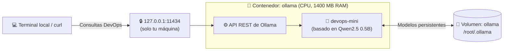

# 🤖 Ejemplo 06: IA Local en Docker con Ollama (Asistente DevOps sin GPU)

En este laboratorio vas a correr un **modelo de lenguaje (LLM) dentro de un contenedor Docker**, usando solo la CPU, sin instalar Python, CUDA ni drivers de GPU. Luego crearás tu propio asistente **`devops-mini`** especializado en Linux, Docker y Kubernetes, y lo consultarás por terminal y por su **API REST**.

Aquí juntas todo lo que viste en los ejemplos anteriores: imágenes oficiales, **volúmenes** (ejemplo 04), **puertos** (ejemplos 01 y 02), **límites de recursos** (`--memory`, `--cpus`), `docker exec` y **escaneo con Trivy**.

---

## 🧠 ¿Qué es Ollama?

[**Ollama**](https://ollama.com) es una herramienta de código abierto para **descargar, ejecutar y personalizar modelos de lenguaje en tu propia máquina**. Funciona de forma muy parecida a Docker:

| En Docker | En Ollama | ¿Qué significa? |
| :--- | :--- | :--- |
| `docker pull nginx:alpine` | `ollama pull qwen2.5:0.5b` | Descarga un artefacto desde un registro público. |
| `docker run` | `ollama run` | Arranca y usas el artefacto. |
| `Dockerfile` | `Modelfile` | "Receta" para crear una versión personalizada a partir de una base (`FROM`). |
| `docker build -t mi-app .` | `ollama create devops-mini -f Modelfile` | Construye tu artefacto derivado. |
| Docker Hub | [ollama.com/library](https://ollama.com/library) | Catálogo de modelos disponibles. |
| Docker Engine API | API REST en el puerto `11434` | Permite integrarlo con aplicaciones (Python, FastAPI, etc.). |

En este laboratorio usamos **Qwen2.5 0.5B** (≈400 MB): un modelo pequeño que corre en CPU con poca RAM. Es ideal para aprender, aunque tiene límites claros (ver [Expectativas realistas](#-expectativas-realistas)).

### 📚 Documentación oficial

| Recurso | Enlace |
| :--- | :--- |
| Sitio oficial de Ollama | [ollama.com](https://ollama.com) |
| Documentación general | [docs.ollama.com](https://docs.ollama.com) |
| Ollama en Docker | [docs.ollama.com/docker](https://docs.ollama.com/docker) |
| Referencia del `Modelfile` | [docs.ollama.com/modelfile](https://docs.ollama.com/modelfile) |
| Referencia de la API REST | [docs.ollama.com/api](https://docs.ollama.com/api) |
| Imagen oficial en Docker Hub | [hub.docker.com/r/ollama/ollama](https://hub.docker.com/r/ollama/ollama) |
| Modelo Qwen2.5 | [ollama.com/library/qwen2.5](https://ollama.com/library/qwen2.5) |
| Código fuente | [github.com/ollama/ollama](https://github.com/ollama/ollama) |

---

## ☕ La Analogía Paisa: El Barista Aprendiz del Carrito

* **La imagen `ollama/ollama`:** La greca profesional, lista para preparar cualquier receta.
* **El modelo `qwen2.5:0.5b`:** Un barista aprendiz. Sabe lo básico, es rápido y cabe en un carrito pequeño (poca RAM).
* **El `Modelfile`:** El uniforme y el manual de la casa. Le dice al aprendiz: *"Aquí solo se habla de DevOps, en español, con respuestas cortas y sin inventar"*.
* **El volumen `ollama`:** La bodega donde se guarda lo que el barista aprendió. Si cambias el carrito (borras el contenedor), no tienes que volver a descargar el modelo.
* **`127.0.0.1:11434`:** La ventanilla del carrito solo atiende a quien está dentro de la estación (tu máquina), no a cualquiera que pase por la calle (Internet).

---

## 🏗️ Arquitectura del Laboratorio



---

## 📄 Estructura del Ejemplo

```text
06-ia-local-ollama/
├── Modelfile    # Receta del asistente devops-mini (modelo base + parámetros + instrucciones)
└── README.md    # Esta guía paso a paso
```

---

## ✅ Requisitos Previos

* Docker funcionando (`docker ps` sin errores).
* Al menos **2 GB de RAM libres** y unos **2 GB de disco** (imagen + modelo).
* En **Docker Desktop (macOS / Windows)**, revisa en *Settings → Resources* que Docker tenga asignados al menos 2 GB de memoria y 3 CPUs. Si tienes menos CPUs, ajusta `--cpus` en el paso 1.

---

## 🚀 Flujo Práctico Paso a Paso

> Todos los comandos se ejecutan desde la **raíz del repositorio**.

### 1. Crear el volumen y levantar Ollama en modo CPU

```bash
# Volumen persistente para los modelos descargados
docker volume create ollama

# Contenedor de Ollama con límites de recursos
docker run -d \
  --name ollama \
  --restart unless-stopped \
  --memory=1400m \
  --cpus=3 \
  -p 127.0.0.1:11434:11434 \
  -v ollama:/root/.ollama \
  ollama/ollama
```

| Flag | ¿Para qué sirve? |
| :--- | :--- |
| `--restart unless-stopped` | Si el contenedor se cae o reinicias Docker, vuelve a arrancar solo (salvo que lo detengas tú). |
| `--memory=1400m` | Límite máximo de RAM. Si se supera, el kernel mata el proceso (**OOM**) en lugar de congelar tu máquina. |
| `--cpus=3` | Máximo de núcleos de CPU que puede usar la inferencia. |
| `-p 127.0.0.1:11434:11434` | Publica la API **solo en localhost**. Nadie de tu red puede conectarse. |
| `-v ollama:/root/.ollama` | Guarda los modelos en el volumen; sobreviven a `docker rm`. |

Verifica que esté corriendo:

```bash
docker ps -a
docker logs ollama
```

> 🌉 **Puente a Kubernetes:** `--memory` y `--cpus` son el antecedente directo de los `resources.limits` que configurarás en los Pods.

---

### 2. Descargar y probar el modelo base

```bash
# Descargar el modelo (≈400 MB, solo la primera vez)
docker exec -it ollama ollama pull qwen2.5:0.5b

# Conversar con el modelo base
docker exec -it ollama ollama run qwen2.5:0.5b
```

Escribe una pregunta y presiona Enter. Para salir escribe **`/bye`** (o `Ctrl + D`).

Revisa los modelos descargados:

```bash
docker exec -it ollama ollama list
```

---

### 3. Configurarlo como asistente DevOps con un `Modelfile`

El archivo [`Modelfile`](./Modelfile) de esta carpeta define el asistente:

```dockerfile
FROM qwen2.5:0.5b

PARAMETER num_ctx 1024
PARAMETER num_predict 256
PARAMETER temperature 0.2

SYSTEM """
Eres un asistente DevOps especializado en Linux,
Docker, Kubernetes, YAML y troubleshooting.
...
"""
```

| Instrucción | Significado |
| :--- | :--- |
| `FROM` | Modelo base, igual que la imagen base en un `Dockerfile`. |
| `num_ctx 1024` | Ventana de contexto de 1.024 tokens: cuánto texto "recuerda" en cada conversación. Menos contexto = menos RAM. |
| `num_predict 256` | Máximo de tokens por respuesta. |
| `temperature 0.2` | Valores bajos dan respuestas más precisas y repetibles; valores altos, más creativas. |
| `SYSTEM` | Instrucciones fijas que definen el rol y las reglas del asistente. |

Crea el modelo personalizado enviando el `Modelfile` al contenedor por la entrada estándar:

```bash
docker exec -i ollama ollama create devops-mini -f /dev/stdin \
  < semana-00-fundamentos-docker/1.ejemplos/06-ia-local-ollama/Modelfile
```

<details>
<summary>💡 Alternativa: copiar el archivo dentro del contenedor con <code>docker cp</code></summary>

```bash
docker cp semana-00-fundamentos-docker/1.ejemplos/06-ia-local-ollama/Modelfile ollama:/tmp/Modelfile
docker exec -it ollama ollama create devops-mini -f /tmp/Modelfile
```
</details>

Verifica que aparezca `devops-mini`:

```bash
docker exec -it ollama ollama list
```

> ⚠️ El contexto de 1.024 tokens y las respuestas de hasta 256 tokens reducen el consumo de memoria, pero también **limitan cuánto texto puede analizar o generar** el modelo.

---

### 4. Probar el asistente en la terminal

```bash
docker exec -it ollama ollama run devops-mini
```

Prueba con preguntas como:

* `¿Cómo identifico un pod en CrashLoopBackOff?`
* `Explícame este error de Docker: permission denied.`
* `Genera un Deployment de Kubernetes con 2 réplicas y probes de salud.`
* `¿Qué comandos uso para revisar los eventos de un namespace?`

> 🧪 **Reto de criterio:** Compara la respuesta con lo que aprendiste en la Semana 0. ¿El modelo inventó algún flag? ¿El YAML generado es válido? Un modelo de 0.5B se equivoca con frecuencia: **tú eres quien valida**.

---

### 5. Consumir la API REST local

En **otra terminal**, consulta el modelo como lo haría una aplicación:

```bash
curl http://127.0.0.1:11434/api/chat \
  -H 'Content-Type: application/json' \
  -d '{
    "model": "devops-mini",
    "messages": [
      {
        "role": "user",
        "content": "Dame los comandos para diagnosticar un pod en CrashLoopBackOff."
      }
    ],
    "stream": false,
    "options": {
      "num_ctx": 1024,
      "num_predict": 256
    }
  }'
```

La API responde en JSON. El texto generado está en el campo `message.content`. Si tienes `jq` instalado, puedes extraerlo así:

```bash
curl -s http://127.0.0.1:11434/api/chat \
  -d '{"model":"devops-mini","stream":false,"messages":[{"role":"user","content":"¿Qué hace docker exec?"}]}' \
  | jq -r '.message.content'
```

Más endpoints disponibles:

```bash
# Listar los modelos instalados
curl -s http://127.0.0.1:11434/api/tags

# Ver la versión de Ollama
curl -s http://127.0.0.1:11434/api/version
```

> 🔌 Esta misma API se puede integrar después con una aplicación en Python o FastAPI. Consulta la [referencia de la API](https://docs.ollama.com/api).

---

### 6. Persistencia: el volumen en acción

Comprueba lo que aprendiste en el ejemplo 04: destruye el contenedor y créalo de nuevo con el mismo volumen.

```bash
docker rm -f ollama

docker run -d --name ollama --restart unless-stopped \
  --memory=1400m --cpus=3 \
  -p 127.0.0.1:11434:11434 \
  -v ollama:/root/.ollama \
  ollama/ollama

docker exec -it ollama ollama list
```

🎉 **Resultado:** `qwen2.5:0.5b` y `devops-mini` siguen ahí. No hubo que descargar nada de nuevo.

---

### 7. Monitorear memoria y recursos

Los modelos de IA consumen mucha RAM. Vigila el contenedor mientras le haces preguntas:

```bash
# Consumo en vivo de CPU y RAM del contenedor (Ctrl + C para salir)
docker stats ollama

# ¿El contenedor fue terminado por falta de memoria?
docker inspect ollama --format '{{.State.OOMKilled}}'
```

En un **servidor Linux**, revisa también la memoria del host, el swap y los registros del kernel:

```bash
free -h
dmesg -T | grep -i -E 'oom|killed process'
```

> ⚠️ Si tu servidor tiene **2 GB de RAM y 0 GB de swap**, los errores **OOM (Out Of Memory)** son probables. Si `OOMKilled` devuelve `true`, sube `--memory` o usa un modelo más pequeño.

---

### 8. Escaneo de Seguridad con Trivy (CLI)

Como en todos los laboratorios, audita la imagen antes de confiar en ella:

```bash
# Con Trivy instalado como paquete:
trivy image --severity HIGH,CRITICAL ollama/ollama

# Alternativa con contenedor efímero:
docker run --rm -v /var/run/docker.sock:/var/run/docker.sock aquasec/trivy:latest image --severity HIGH,CRITICAL ollama/ollama
```

> 🛡️ **Punto de análisis:** A diferencia de nuestras imágenes basadas en Alpine, `ollama/ollama` usa una base Ubuntu e incluye librerías para GPU, así que es **mucho más pesada** y puede reportar vulnerabilidades. Compara el tamaño con `docker images ollama/ollama` y discute: ¿qué haría tu equipo de seguridad antes de llevarla a producción? Consulta la [Guía de Seguridad con Trivy](../../../recursos/guia-trivy-seguridad.md).

---

### 9. Limpieza

```bash
# Eliminar el contenedor
docker rm -f ollama

# (Opcional) Eliminar los modelos descargados. ⚠️ Tendrás que descargarlos de nuevo.
docker volume rm ollama

# (Opcional) Eliminar la imagen
docker rmi ollama/ollama
```

---

## 🔐 Recomendaciones de Seguridad

| Recomendación | ¿Por qué? |
| :--- | :--- |
| **No expongas el puerto a la red** | Mantén `127.0.0.1:11434:11434`. La API de Ollama **no tiene autenticación por defecto**: si usas `-p 11434:11434`, cualquiera en tu red (o en Internet) podría usar tu modelo y tus recursos. |
| **No montes el socket de Docker** | Nunca añadas `-v /var/run/docker.sock:/var/run/docker.sock` al contenedor de IA. Quien controla el socket controla el host. |
| **No ejecutes comandos sugeridos automáticamente** | Usa el modelo para *proponer* comandos y revísalos antes de ejecutarlos, sobre todo `kubectl delete`, `rm -rf`, cambios de permisos y operaciones sobre producción. |
| **Limita los recursos** | `--memory` y `--cpus` evitan que la inferencia deje sin recursos al resto del sistema. |
| **Escanea la imagen** | Revisa con Trivy las vulnerabilidades de cualquier imagen de terceros antes de usarla. |

---

## 🎯 Expectativas Realistas

Este laboratorio te sirve para aprender **inferencia local, integración por API y automatización segura**.

Para analizar manifiestos extensos, diagnosticar problemas complejos de Kubernetes o razonar sobre varios logs a la vez, **el modelo de 0.5B se quedará corto**. La mejora más importante es disponer de más RAM y pasar a un modelo más grande (por ejemplo `qwen2.5:1.5b`, `qwen2.5:3b` o `qwen2.5:7b`), cambiando solo la línea `FROM` del `Modelfile`.

| Modelo | Tamaño aprox. | RAM recomendada |
| :--- | :---: | :---: |
| `qwen2.5:0.5b` | ~400 MB | 2 GB |
| `qwen2.5:1.5b` | ~1 GB | 4 GB |
| `qwen2.5:3b` | ~1.9 GB | 6 GB |
| `qwen2.5:7b` | ~4.7 GB | 8–16 GB |

---

## 🧠 Conceptos Clave Aprendidos

| Concepto | Lo que practicaste |
| :--- | :--- |
| **Imágenes oficiales de terceros** | Ejecutar software complejo (un LLM) sin instalar dependencias en el host. |
| **Límites de recursos** | `--memory` y `--cpus` para controlar el consumo y evitar que se congele la máquina. |
| **Volúmenes** | Persistir artefactos pesados (modelos) entre recreaciones del contenedor. |
| **Publicación segura de puertos** | Diferencia entre `-p 11434:11434` (toda la red) y `-p 127.0.0.1:11434:11434` (solo local). |
| **`docker exec` y stdin** | Ejecutar herramientas dentro del contenedor y enviarles archivos con `-i` y `<`. |
| **Política de reinicio** | `--restart unless-stopped` como primera forma de "autorreparación". |

---

## 🌉 El Puente a Kubernetes: ¿Cómo se traduce esto?

| En Docker | En Kubernetes |
| :--- | :--- |
| `--memory=1400m --cpus=3` | `resources.limits` y `resources.requests` en el Pod. |
| `-v ollama:/root/.ollama` | **`PersistentVolumeClaim`** para guardar los modelos. |
| `--restart unless-stopped` | `restartPolicy` y el control de un **Deployment**. |
| `-p 127.0.0.1:11434:11434` | Un **Service `ClusterIP`**: accesible solo dentro del clúster. |
| `OOMKilled: true` | Estado `OOMKilled` en `kubectl describe pod`. |

> ☸️ En las próximas semanas verás estos conceptos en YAML; por ahora, quédate con la idea de que **Kubernetes declara lo mismo que hoy escribiste con flags de `docker run`**.
