# 📂 Laboratorios y Ejemplos Prácticos de Docker (Semana 0)

En esta carpeta encontrarás los **6 laboratorios prácticos oficiales** de la Semana 0, organizados de forma incremental. Cada laboratorio está diseñado para resolver un problema real de empaquetado, redes, persistencia, seguridad o distribución antes de dar el salto a Kubernetes.

---

## 🗺️ Resumen Ejecutivo de los 6 Laboratorios

| # | Laboratorio | Tipo de Aplicación | Conceptos Clave de Docker | Herramientas Utilizadas | Guía Paso a Paso |
| :-: | :--- | :--- | :--- | :--- | :--- |
| **01** | [`01-servidor-web-html/`](./01-servidor-web-html) | Sitio Web Estático (Nginx) | `FROM`, `COPY`, `EXPOSE` y `CMD` en primer plano (`daemon off;`) sobre imagen minimalista Alpine (~25 MB). | Docker, Nginx, Alpine | 🔗 [Ver Laboratorio 01](./01-servidor-web-html/README.md) |
| **02** | [`02-app-python-api/`](./02-app-python-api) | API REST en Python (Microservicio) | Usuario sin privilegios (`USER appuser`), `COPY --chown`, variables `ENV`, `.dockerignore`, PID 1 y UI interactiva. | Docker, Python, Alpine | 🔗 [Ver Laboratorio 02](./02-app-python-api/README.md) |
| **03** | [`03-redes-comunicacion-contenedores/`](./03-redes-comunicacion-contenedores) | Microservicios en Red Bridge | Redes personalizadas (`docker network create`), resolución DNS automática por nombre y aislamiento entre contenedores. | Docker Networks, DNS interno | 🔗 [Ver Laboratorio 03](./03-redes-comunicacion-contenedores/README.md) |
| **04** | [`04-almacenamiento-y-volumenes/`](./04-almacenamiento-y-volumenes) | API con Persistencia de Ventas | Capa efímera vs **Named Volumes** (`docker volume`) vs **Bind Mounts** (`-v`), evitando pérdida de datos al recrear contenedores. | Docker Volumes, Bind Mounts | 🔗 [Ver Laboratorio 04](./04-almacenamiento-y-volumenes/README.md) |
| **05** | [`05-registro-imagenes-harbor/`](./05-registro-imagenes-harbor) | Registro Empresarial de Imágenes | Autenticación (`docker login`), nomenclatura OCI (`docker tag`), publicación (`docker push`), descarga (`docker pull`) y Cuentas Robot. | Docker CLI, Harbor, Trivy | 🔗 [Ver Laboratorio 05](./05-registro-imagenes-harbor/README.md) |
| **06** | [`06-ia-local-ollama/`](./06-ia-local-ollama) | IA Local y Asistente DevOps (LLM) | Inferencia de LLM en CPU, límites de recursos (`--memory`, `--cpus`), `Modelfile` personalizado y API REST en localhost (`127.0.0.1:11434`). | Docker, Ollama, Qwen2.5 | 🔗 [Ver Laboratorio 06](./06-ia-local-ollama/README.md) |

---

## 📋 ¿Qué Aprenderás en Cada Laboratorio?

```mermaid
flowchart LR
    L1["01. Servidor Web\n(HTML + Nginx)"] --> L2["02. API Python\n(Non-root + ENV)"]
    L2 --> L3["03. Redes Bridge\n(DNS por Nombre)"]
    L3 --> L4["04. Volúmenes\n(Persistencia)"]
    L4 --> L5["05. Harbor Registry\n(Tag, Push & Pull)"]
    L5 --> L6["06. IA Local\n(Ollama en CPU)"]

    style L1 fill:#e1f5fe,stroke:#0288d1,stroke-width:2px,color:#000
    style L2 fill:#e8f5e9,stroke:#388e3c,stroke-width:2px,color:#000
    style L3 fill:#fff3e0,stroke:#f57c00,stroke-width:2px,color:#000
    style L4 fill:#fce4ec,stroke:#c2185b,stroke-width:2px,color:#000
    style L5 fill:#e8eaf6,stroke:#3f51b5,stroke-width:2px,color:#000
    style L6 fill:#f3e5f5,stroke:#7b1fa2,stroke-width:2px,color:#000
```

1. **[01-servidor-web-html](./01-servidor-web-html/README.md):** Tu primer contenedor web funcional. Aprende por qué Nginx necesita correr en primer plano para mantener vivo el contenedor y cómo servir archivos estáticos con imágenes ultra ligeras.
2. **[02-app-python-api](./02-app-python-api/README.md):** Buenas prácticas obligatorias de producción. Crea un usuario no-root (`appuser`), parametriza con variables de entorno (`ENV`), excluye archivos innecesarios con `.dockerignore` y prueba la app en una interfaz web animada.
3. **[03-redes-comunicacion-contenedores](./03-redes-comunicacion-contenedores/README.md):** Conecta dos microservicios (Greca Backend y Carrito Cliente) mediante una red bridge personalizada y comprueba por qué `localhost` falla entre contenedores mientras el DNS interno de Docker resuelve por nombre.
4. **[04-almacenamiento-y-volumenes](./04-almacenamiento-y-volumenes/README.md):** Demuestra la diferencia entre perder todos los datos en la capa efímera al borrar un contenedor versus persistirlos de forma segura usando **Named Volumes** o sincronizarlos en vivo con **Bind Mounts**.
5. **[05-registro-imagenes-harbor](./05-registro-imagenes-harbor/README.md):** Distribuye tus imágenes en un registro empresarial. Aprende las reglas de etiquetado OCI (`docker tag`), la autenticación con Cuentas Robot (`docker login`), la subida eficiente por capas (`docker push`) y la descarga limpia (`docker pull`).
6. **[06-ia-local-ollama](./06-ia-local-ollama/README.md):** Ejecuta un modelo de lenguaje (Qwen2.5) 100% en CPU dentro de un contenedor. Limita memoria (`--memory`) y procesadores (`--cpus`), crea un asistente DevOps personalizado con un `Modelfile` y consúltalo vía API REST en `127.0.0.1`.

---

## 🛠️ Herramientas del Ecosistema: Enlaces a sus Guías Detalladas

Para mantener estos laboratorios prácticos y concisos, la teoría profunda, instalación y comandos avanzados de cada herramienta de soporte se encuentran documentados en la carpeta [**`recursos/`**](../../recursos):

| Herramienta | ¿Para qué se usa en el workshop? | Guía Completa de Referencia |
| :--- | :--- | :--- |
| 🛡️ **Trivy** | Escaneo de vulnerabilidades (CVEs) en paquetes de sistema operativo, dependencias de código y malas prácticas en `Dockerfile`. | 📖 [**Guía Completa de Trivy**](../../recursos/guia-trivy-seguridad.md) |
| ⚓ **Harbor** | Registro empresarial OCI privado (CNCF Graduated) con control de acceso RBAC, Cuentas Robot, políticas de seguridad y replicación. | 📖 [**Guía Empresarial de Harbor**](../../recursos/guia-harbor-registry.md) |
| 🤖 **Ollama** | Motor de inferencia local de Modelos de Lenguaje (LLMs) en contenedores, sin GPU obligatoria, sin costos por token y con total privacidad. | 📖 [**Guía de IA Local con Ollama**](../../recursos/guia-ollama-ia-local.md) |
| ☕ **Analogía del Tinto** | El hilo conductor pedagógico que explica desde una taza de café en el Metro de Medellín hasta Pods, Services y Deployments. | 📖 [**De un Tinto a Kubernetes**](../../recursos/de-un-tinto-a-kubernetes.md) |

---

> [!TIP]
> 👉 **¿Cuándo entra Kubernetes?**  
> En la **Semana 1** aprenderás a instalar tu clúster local con **Kind** y a orquestar estas mismas imágenes usando Pods, Services y Deployments en YAML.
