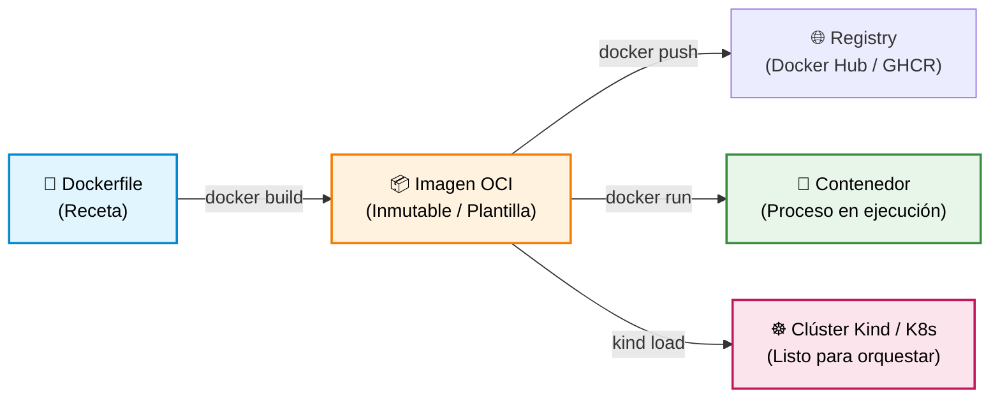

# 🐳 Semana 0: Fundamentos de Docker — De Código a Contenedor para Kubernetes

¡Bienvenido al punto de partida! Antes de que Kubernetes pueda orquestar, balancear y autorreparar aplicaciones, necesitamos lo más elemental: **el contenedor**.

En este módulo aprenderás qué es realmente un contenedor, cómo escribir un `Dockerfile`, cómo construir y correr imágenes con Docker, y el truco fundamental para conectar tus imágenes locales directamente con tu clúster de **Kind**.

---

## 🧠 Resumen en 2 minutos (Sin enredos)

Seguro has escuchado el dilema más viejo de la informática:
> *— "¡Pero en mi máquina sí funciona!"*  
> *— "¡Pues entonces llevemos tu máquina a producción!"* 😅

Eso es exactamente lo que hace un contenedor: empaqueta tu código junto con sus dependencias, librerías, variables y configuraciones en una unidad estándar, inmutable y ligera.

### ¿Máquinas Virtuales (VMs) vs. Contenedores?

```mermaid
graph TB
    subgraph VM ["🖥️ Máquina Virtual (Pesada)"]
        A1["Tu Aplicación"] --> L1["Librerías / Binarios"]
        L1 --> OS1["Sistema Operativo Completo (Guest OS: GBs)"]
        OS1 --> HYP["Hipervisor (VirtualBox, VMware)"]
        HYP --> HOST1["Sistema Operativo Host e Infraestructura"]
    end

    subgraph DOCKER ["🐳 Contenedores (Ligeros)"]
        A2["Tu Aplicación"] --> L2["Librerías / Binarios"]
        L2 --> DE["Docker Engine / Contenedor"]
        DE --> KERNEL["Kernel Compartido del Sistema Operativo (Linux)"]
        KERNEL --> HOST2["Infraestructura"]
    end
```

* **Máquina Virtual:** Incluye un sistema operativo entero dentro de otro. Tarda minutos en encender y consume gigabytes de RAM.
* **Contenedor:** No duplica el sistema operativo. Comparte el **Kernel de Linux** con el anfitrión y aísla los procesos mediante dos tecnologías nativas:
  * **Namespaces:** Le dan al contenedor la ilusión de tener su propia red, sus propios procesos (PID 1) y su propio sistema de archivos.
  * **Cgroups (Control Groups):** Le ponen un techo de consumo de CPU y memoria RAM para que no tumbe el computador anfitrión.

---

### La analogía del tinto colombiano ☕ (El hilo conductor del workshop)

Para entender esto sin complicaciones, piensa en cómo funciona un buen tinto en Medellín:

* **Los Granos de café:** Es tu código fuente (`app.py`, `index.html`, etc.). La materia prima sin procesar.
* **El `Dockerfile` (La Receta):** Indica cómo tostar, moler y preparar el café. Es la receta escrita paso a paso.
* **La Imagen de Docker (La Bolsa de café sellada):** Es la bolsa de café molido sellada al vacío que compras en la tienda. Es inmutable: la construyes una vez y la puedes llevar a Medellín, Bogotá o Tokio; sabe exactamente igual en todas partes.
* **El Contenedor (La Greca preparando el tinto):** Es la greca encendida pasando agua caliente por el café molido. La aplicación cobrando vida, lista para servir peticiones.
* **El Pod (El Carrito de tintos):** Es la unidad donde montas la greca junto con los vasitos desechables y el azúcar (recursos compartidos).
* **Kubernetes (La Administración del Metro en hora pico):** Coordina una red de carritos en las estaciones. Si a un carrito se le apaga la greca, envía otro inmediatamente; si dan las 7:00 a. m., activa 10 carritos más para que nadie se quede sin tinto.

👉 *¿Quieres leer la historia completa con todos los componentes de Kubernetes? Lee la guía comunitaria: [**De un Tinto Colombiano a Kubernetes**](../recursos/de-un-tinto-a-kubernetes.md).*

---

## 🧩 Anatomía del Ecosistema Docker

1. **`Dockerfile`:** Archivo de texto plano con instrucciones para construir la imagen.
2. **Imagen (`Image`):** Paquete de solo lectura compuesto por capas. Es inmutable: si cambias una línea de código, se genera una nueva versión/tag.
3. **Contenedor (`Container`):** Una instancia viva de una imagen. Agrega una capa temporal de lectura y escritura encima de la imagen.
4. **Registro (`Registry`):** Catálogo remoto (como Docker Hub o GitHub Packages) donde almacenas y descargas imágenes con `docker pull` y `docker push`.

---

## 🛠️ Comandos Esenciales de Docker (Día a Día)

| ¿Qué quiero hacer? | Comando | Explicación sencilla |
| :--- | :--- | :--- |
| **Construir una imagen** | `docker build -t mi-app:v1.0 .` | Lee el `Dockerfile` en el directorio actual (`.`) y le pone el tag `mi-app:v1.0`. |
| **Listar imágenes locales** | `docker images` | Muestra qué imágenes tienes descargadas o construidas en tu máquina. |
| **Correr un contenedor** | `docker run -d -p 8080:80 --name mi-servidor nginx:alpine` | `-d`: en segundo plano. `-p 8080:80`: conecta puerto 8080 de tu máquina con el 80 del contenedor. `--name`: nombre amigable. |
| **Ver contenedores activos** | `docker ps` | Muestra los contenedores que están corriendo actualmente. |
| **Ver todos los contenedores** | `docker ps -a` | Muestra activos y detenidos (útil si fallaron al arrancar). |
| **Ver logs en vivo** | `docker logs -f mi-servidor` | Muestra la salida estándar y errores que escupe la app. |
| **Entrar a la terminal del contenedor** | `docker exec -it mi-servidor sh` | Abre una terminal interactiva (`-it`) dentro del contenedor. |
| **Detener un contenedor** | `docker stop mi-servidor` | Envía una señal `SIGTERM` para apagarlo limpiamente. |
| **Eliminar un contenedor** | `docker rm mi-servidor` | Elimina el contenedor detenido de tu disco. |
| **Limpiar contenedores e imágenes huérfanas** | `docker system prune` | Libera espacio en disco eliminando capas que ya no usas. |

---

## 🛡️ Buenas Prácticas al Construir Imágenes (De Novato a Pro)

Construir una imagen no es solo hacer que compile; en entornos de producción y Kubernetes la **seguridad**, el **tamaño** y el **rendimiento** son críticos:

| Buena Práctica | ¿Por qué es obligatoria? | Ejemplo en el `Dockerfile` |
| :--- | :--- | :--- |
| **1. Nunca corras como `root`** | Por defecto los contenedores corren como superusuario (UID 0). Si tu app es vulnerada, el atacante puede escapar al host o nodo de K8s. | `RUN adduser -u 10001 -S appuser` `USER appuser` |
| **2. Usa siempre `.dockerignore`** | Evita que se filtren contraseñas (`.env`), llaves SSH o carpetas pesadas (`.git/`, `node_modules/`, cachés). | Crear archivo `.dockerignore` listando `.env`, `*.log`, `.git/`. |
| **3. Fija versiones (Pinned Tags)** | Evita usar `:latest` porque puede cambiar en cualquier momento y romper tu despliegue sin previo aviso. | `FROM python:3.12-alpine` en lugar de `FROM python:latest`. |
| **4. Asigna propiedad al copiar (`--chown`)** | Evita errores de permisos donde el usuario sin privilegios no puede leer o escribir sus propios archivos. | `COPY --chown=appuser:appgroup app.py .` |
| **5. Escucha en `0.0.0.0`, no en `127.0.0.1`** | En Docker, `127.0.0.1` es el loopback interno y rechazará peticiones que vengan de fuera del contenedor. | `HTTPServer(("0.0.0.0", 8080), ...)` |
| **6. Usa la forma `exec` en `CMD`** | Usar corchetes `["python", "app.py"]` permite que el proceso reciba señales del SO (`SIGTERM`) para apagarse limpiamente. | `CMD ["python", "app.py"]` en vez de `CMD python app.py`. |

---

## 🌉 El Gran Puente: ¿Por qué Docker no basta y necesitamos Kubernetes?

Docker es extraordinario para empaquetar y ejecutar un contenedor en **una sola máquina**. Pero en producción real surgen problemas que Docker solo no resuelve:

| Pregunta de Producción | Con Docker solo | Con Kubernetes (Orquestador) |
| :--- | :--- | :--- |
| **¿Qué pasa si el servidor físico se apaga a las 3 a.m.?** | Tu contenedor muere hasta que alguien entre manualmente a levantarlo. | **Self-healing:** K8s detecta el nodo caído y recrea los Pods en otro servidor en segundos. |
| **¿Llegó el Black Friday y el tráfico se multiplicó por 10?** | Tienes que entrar por SSH a varios servidores y hacer `docker run` a mano. | **Auto-scaling:** K8s escala automáticamente las réplicas según uso de CPU/RAM. |
| **¿Cómo actualizo la versión sin cortar el servicio?** | Detienes el contenedor viejo y arrancas el nuevo (caída de servicio de unos segundos/minutos). | **Rolling Updates:** K8s levanta la versión nueva, espera que esté lista (`Ready`) y luego apaga la vieja con cero caída. |
| **¿Quién balancea la carga entre 15 réplicas?** | Tienes que configurar un Nginx o HAProxy externo manualmente. | **Service:** K8s te entrega una IP interna estable y balancea el tráfico automáticamente entre todos los Pods. |

### Tabla de Equivalencias: De Docker a Kubernetes

| Concepto en Docker (Imperativo) | Equivalente en Kubernetes (Declarativo) |
| :--- | :--- |
| `docker run -d --name app -p 8080:80 nginx:alpine` | Archivo `pod.yaml` con `containerPort: 80` + `kubectl apply -f pod.yaml` |
| `docker ps` | `kubectl get pods` |
| `docker logs -f app` | `kubectl logs -f app` |
| `docker exec -it app sh` | `kubectl exec -it app -- sh` |
| `docker stop app && docker rm app` | `kubectl delete pod app` |
| Redes de Docker (`docker network create`) | **CNI** y abstracción de `Service` (ClusterIP / NodePort) |
| Volúmenes (`docker run -v host:cont`) | **PersistentVolumeClaims (PVC)** y `emptyDir` |

---

## 🧪 Laboratorios y Ejemplos Prácticos (`1.ejemplos/`)

Cada ejemplo cuenta con su propio código fuente ejecutable, su `Dockerfile` y su guía detallada paso a paso:

| # | Laboratorio | Conceptos Clave | Guía Paso a Paso |
| :-: | :--- | :--- | :--- |
| **01** | **Servidor Web Estático** | `FROM`, `COPY`, `EXPOSE` y `CMD` con Nginx sobre Alpine Linux (~25MB). | 🔗 [Ver Guía del Ejemplo 01](./1.ejemplos/01-servidor-web-html/README.md) |
| **02** | **API REST con Buenas Prácticas** | Usuario no-root (`appuser`), variables de entorno (`ENV`), `.dockerignore`, proceso PID 1 e interfaz interactiva animada. | 🔗 [Ver Guía del Ejemplo 02](./1.ejemplos/02-app-python-api/README.md) |
| **03** | **Redes y Comunicación entre Contenedores** | Redes bridge personalizadas (`docker network create`), resolución DNS automática por nombre y aislamiento de red. | 🔗 [Ver Guía del Ejemplo 03](./1.ejemplos/03-redes-comunicacion-contenedores/README.md) |
| **04** | **Almacenamiento y Persistencia con Volúmenes** | Datos efímeros vs **Named Volumes** (`docker volume`) vs **Bind Mounts** (`-v`), evitando la pérdida de datos al recrear contenedores. | 🔗 [Ver Guía del Ejemplo 04](./1.ejemplos/04-almacenamiento-y-volumenes/README.md) |

> [!TIP]
> **¿Prefieres practicar en el navegador sin instalar Docker localmente?**  
> Puedes realizar ejercicios interactivos guiados con terminal lista en la nube en [**KodeKloud Studio — Docker Labs**](https://kodekloud.com/studio/labs/docker).

---

## 💥 Los Retos Rotos de la Semana 0 (100% Docker)

En la carpeta [`2.reto-roto/`](./2.reto-roto/README.md) encontrarás 5 desafíos reales con errores comunes de la industria que debes investigar, depurar y corregir:

| Reto | Tipo de Error / Tema | Nivel | Enlace al Reto |
| :---: | :--- | :---: | :--- |
| **01** | Proceso en segundo plano apaga el contenedor (PID 1) | 🟢 Principiante | 🔗 [Reto 01: Dockerfile Roto](./2.reto-roto/01-dockerfile-roto/README.md) |
| **02** | Contenedor crashea por falta de variable de entorno (`ENV`) | 🟢 Principiante | 🔗 [Reto 02: Variable Faltante](./2.reto-roto/02-variable-entorno-faltante/README.md) |
| **03** | Contenedor vulnerable ejecutándose como `root` (Seguridad) | 🟡 Intermedio | 🔗 [Reto 03: Contenedor Root](./2.reto-roto/03-contenedor-como-root/README.md) |
| **04** | Fuga de contraseñas y secretos por falta de `.dockerignore` | 🟢 Principiante | 🔗 [Reto 04: Archivos Secretos](./2.reto-roto/04-dockerignore-y-archivos-secretos/README.md) |
| **05** | Conexión rechazada por enlazar a `127.0.0.1` y puerto desalineado | 🟢 Principiante | 🔗 [Reto 05: Host Desalineado](./2.reto-roto/05-puerto-y-host-desalineado/README.md) |

> 🚀 **¿Resolviste los retos?** Sube tu solución en `aportes-comunidad/soluciones-retos/<tu-usuario>/semana-00/` y abre tu Pull Request para avanzar en tu rango de tripulación.

---

> [!NOTE]
> ☸️ **¿Cuándo entra Kubernetes?**  
> ¡En la **Semana 1**! Allí aprenderás a crear tu propio clúster local con **Kind**, entenderás el Control Plane y los Worker Nodes, y desplegarás tus primeros Pods en YAML.

---

## 🕵️‍♂️ Diccionario Rápido: ¿Qué le duele a mi Contenedor Docker?

| Síntoma en Docker | Causa más probable | Cómo solucionarlo |
| :--- | :--- | :--- |
| **El contenedor se apaga solo al segundo de iniciarlo** | El proceso principal (PID 1) terminó o se envió a segundo plano (ej: `nginx` sin `daemon off;` o un script que no se queda escuchando). | Asegúrate de que el comando en `CMD` o `ENTRYPOINT` corra en primer plano (*foreground*). |
| **El contenedor termina con `Exited (1)` de inmediato** | Falta una variable de entorno requerida o la app arrojó una excepción al iniciar. | Revisa con `docker logs <contenedor>` e inyecta la variable con `ENV` o `docker run -e`. |
| **`docker run --rm  whoami` responde `root`** | La imagen no declaró la directiva `USER`, por lo que corre con los máximos privilegios de superusuario. | Crea un usuario y grupo no-root en el `Dockerfile` y define `USER <usuario>`. |
| **`curl: (52) Empty reply` o `Connection refused` (Contenedor activo)** | La app dentro del contenedor escucha en `127.0.0.1` (loopback interno) en lugar de `0.0.0.0`, o el puerto interno no coincide con el mapeo. | Enlaza el servidor a `0.0.0.0` y alinea el puerto del proceso con el puerto de la derecha en `-p <host>:<contenedor>`. |
| **Secretos o claves privadas visibles al inspeccionar la imagen** | No existe un archivo `.dockerignore` y se copió toda la carpeta local con `COPY . .`. | Crea un `.dockerignore` excluyendo `.env`, `.git/`, logs y llaves, y copia solo archivos específicos. |
| **`docker: Error response from daemon: Ports are not available`** | El puerto de tu máquina anfitrión ya está ocupado por otra app o por otro contenedor. | Cambia el puerto de la izquierda: `-p 8081:80` o detén el proceso que usa el puerto (`lsof -i :8080`). |
| **El archivo no existe dentro del contenedor** | Olvidaste la instrucción `COPY` en el `Dockerfile` o el archivo fue excluido por `.dockerignore`. | Revisa tu `Dockerfile` y valida que la ruta de origen y destino existan. |

