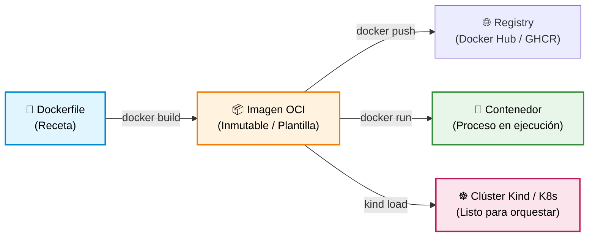

# 🐳 Semana 0: Fundamentos de Docker — De Código a Contenedor para Kubernetes

¡Bienvenido al punto de partida! Antes de que Kubernetes pueda orquestar, balancear y autorreparar aplicaciones, necesitamos lo más elemental: **el contenedor**.

En este módulo aprenderás qué es realmente un contenedor, cómo escribir un `Dockerfile`, cómo construir y correr imágenes con Docker, y el truco fundamental para conectar tus imágenes locales directamente con tu clúster de **Kind**.

---

## 🧠 Resumen en 2 minutos (Sin enredos)

Seguro has escuchado el dilema más viejo de la informática:
> *— "¡Pero en mi máquina sí funciona!"*  
> *— "¡Pues entonces llevemos tu máquina a producción!"* 😅

Eso es exactamente lo que hace un contenedor: empaqueta tu código junto con sus dependencias, librerías, variables y configuraciones en una unidad estándar, inmutable y ligera.

### ¿Máquinas Virtuales (VMs) vs. Contenedores?

```mermaid
graph TB
    subgraph VM ["🖥️ Máquina Virtual (Pesada)"]
        A1["Tu Aplicación"] --> L1["Librerías / Binarios"]
        L1 --> OS1["Sistema Operativo Completo (Guest OS: GBs)"]
        OS1 --> HYP["Hipervisor (VirtualBox, VMware)"]
        HYP --> HOST1["Sistema Operativo Host e Infraestructura"]
    end

    subgraph DOCKER ["🐳 Contenedores (Ligeros)"]
        A2["Tu Aplicación"] --> L2["Librerías / Binarios"]
        L2 --> DE["Docker Engine / Contenedor"]
        DE --> KERNEL["Kernel Compartido del Sistema Operativo (Linux)"]
        KERNEL --> HOST2["Infraestructura"]
    end
```



* **Máquina Virtual:** Incluye un sistema operativo entero dentro de otro. Tarda minutos en encender y consume gigabytes de RAM.
* **Contenedor:** No duplica el sistema operativo. Comparte el **Kernel de Linux** con el anfitrión y aísla los procesos mediante dos tecnologías nativas:
  * **Namespaces:** Le dan al contenedor la ilusión de tener su propia red, sus propios procesos (PID 1) y su propio sistema de archivos.
  * **Cgroups (Control Groups):** Le ponen un techo de consumo de CPU y memoria RAM para que no tumbe el computador anfitrión.

---

### La analogía del tinto colombiano ☕ (El hilo conductor del workshop)

Para entender esto sin complicaciones, piensa en cómo funciona un buen tinto en Medellín:

* **Los Granos de café:** Es tu código fuente (`app.py`, `index.html`, etc.). La materia prima sin procesar.
* **El `Dockerfile` (La Receta):** Indica cómo tostar, moler y preparar el café. Es la receta escrita paso a paso.
* **La Imagen de Docker (La Bolsa de café sellada):** Es la bolsa de café molido sellada al vacío que compras en la tienda. Es inmutable: la construyes una vez y la puedes llevar a Medellín, Bogotá o Tokio; sabe exactamente igual en todas partes.
* **El Contenedor (La Greca preparando el tinto):** Es la greca encendida pasando agua caliente por el café molido. La aplicación cobrando vida, lista para servir peticiones.
* **El Pod (El Carrito de tintos):** Es la unidad donde montas la greca junto con los vasitos desechables y el azúcar (recursos compartidos).
* **Kubernetes (La Administración del Metro en hora pico):** Coordina una red de carritos en las estaciones. Si a un carrito se le apaga la greca, envía otro inmediatamente; si dan las 7:00 a. m., activa 10 carritos más para que nadie se quede sin tinto.

👉 *¿Quieres leer la historia completa con todos los componentes de Kubernetes? Lee la guía comunitaria: [**De un Tinto Colombiano a Kubernetes**](../recursos/de-un-tinto-a-kubernetes.md).*

---

## 🧩 Anatomía del Ecosistema Docker



1. **`Dockerfile`:** Archivo de texto plano con instrucciones para construir la imagen.
2. **Imagen (`Image`):** Paquete de solo lectura compuesto por capas. Es inmutable: si cambias una línea de código, se genera una nueva versión/tag.
3. **Contenedor (`Container`):** Una instancia viva de una imagen. Agrega una capa temporal de lectura y escritura encima de la imagen.
4. **Registro (`Registry`):** Catálogo remoto (como Docker Hub o GitHub Packages) donde almacenas y descargas imágenes con `docker pull` y `docker push`.

---

## 🛠️ Comandos Esenciales de Docker (Día a Día)

| ¿Qué quiero hacer? | Comando | Explicación sencilla |
| :--- | :--- | :--- |
| **Construir una imagen** | `docker build -t mi-app:v1.0 .` | Lee el `Dockerfile` en el directorio actual (`.`) y le pone el tag `mi-app:v1.0`. |
| **Listar imágenes locales** | `docker images` | Muestra qué imágenes tienes descargadas o construidas en tu máquina. |
| **Correr un contenedor** | `docker run -d -p 8080:80 --name mi-servidor nginx:alpine` | `-d`: en segundo plano.<br>`-p 8080:80`: conecta puerto 8080 de tu máquina con el 80 del contenedor.<br>`--name`: nombre amigable. |
| **Ver contenedores activos** | `docker ps` | Muestra los contenedores que están corriendo actualmente. |
| **Ver todos los contenedores** | `docker ps -a` | Muestra activos y detenidos (útil si fallaron al arrancar). |
| **Ver logs en vivo** | `docker logs -f mi-servidor` | Muestra la salida estándar y errores que escupe la app. |
| **Entrar a la terminal del contenedor** | `docker exec -it mi-servidor sh` | Abre una terminal interactiva (`-it`) dentro del contenedor. |
| **Detener un contenedor** | `docker stop mi-servidor` | Envía una señal `SIGTERM` para apagarlo limpiamente. |
| **Eliminar un contenedor** | `docker rm mi-servidor` | Elimina el contenedor detenido de tu disco. |
| **Limpiar contenedores e imágenes huérfanas** | `docker system prune` | Libera espacio en disco eliminando capas que ya no usas. |

---

## 🌉 El Gran Puente: ¿Por qué Docker no basta y necesitamos Kubernetes?

Docker es extraordinario para empaquetar y ejecutar un contenedor en **una sola máquina**. Pero en producción real surgen problemas que Docker solo no resuelve:

| Pregunta de Producción | Con Docker solo | Con Kubernetes (Orquestador) |
| :--- | :--- | :--- |
| **¿Qué pasa si el servidor físico se apaga a las 3 a.m.?** | Tu contenedor muere hasta que alguien entre manualmente a levantarlo. | **Self-healing:** K8s detecta el nodo caído y recrea los Pods en otro servidor en segundos. |
| **¿Llegó el Black Friday y el tráfico se multiplicó por 10?** | Tienes que entrar por SSH a varios servidores y hacer `docker run` a mano. | **Auto-scaling:** K8s escala automáticamente las réplicas según uso de CPU/RAM. |
| **¿Cómo actualizo la versión sin cortar el servicio?** | Detienes el contenedor viejo y arrancas el nuevo (caída de servicio de unos segundos/minutos). | **Rolling Updates:** K8s levanta la versión nueva, espera que esté lista (`Ready`) y luego apaga la vieja con cero caída. |
| **¿Quién balancea la carga entre 15 réplicas?** | Tienes que configurar un Nginx o HAProxy externo manualmente. | **Service:** K8s te entrega una IP interna estable y balancea el tráfico automáticamente entre todos los Pods. |

### Tabla de Equivalencias: De Docker a Kubernetes

| Concepto en Docker (Imperativo) | Equivalente en Kubernetes (Declarativo) |
| :--- | :--- |
| `docker run -d --name app -p 8080:80 nginx:alpine` | Archivo `pod.yaml` con `containerPort: 80` + `kubectl apply -f pod.yaml` |
| `docker ps` | `kubectl get pods` |
| `docker logs -f app` | `kubectl logs -f app` |
| `docker exec -it app sh` | `kubectl exec -it app -- sh` |
| `docker stop app && docker rm app` | `kubectl delete pod app` |
| Redes de Docker (`docker network create`) | **CNI** y abstracción de `Service` (ClusterIP / NodePort) |
| Volúmenes (`docker run -v host:cont`) | **PersistentVolumeClaims (PVC)** y `emptyDir` |

---

## ⚡ El Truco de Oro para el Workshop: Kind y las Imágenes Locales

Cuando usas Kubernetes en la nube (EKS, GKE, AKS), normalmente debes:
1. Construir la imagen con `docker build`.
2. Subirla a un registro público o privado (`docker push`).
3. Kubernetes la descarga desde internet (`imagePullPolicy: Always`).

**¡Pero en nuestro laboratorio local no necesitas subir nada a internet!**  
Si estás usando un clúster local de **Kind**, puedes inyectar directamente la imagen construida en tu Docker local al clúster con un solo comando:

```bash
# Inyectar tu imagen local a los nodos de Kind
kind load docker-image mi-api-cnm:v1.0 --name cnm-lab
```

> [!IMPORTANT]
> **El secreto del YAML en Kubernetes:**  
> En el manifiesto del Pod, siempre debes especificar:
> ```yaml
> spec:
>   containers:
>     - name: mi-app
>       image: mi-api-cnm:v1.0
>       imagePullPolicy: IfNotPresent  # 👈 ¡Obligatorio! Evita que K8s intente buscarla en Docker Hub
> ```

---

## 🧪 Laboratorio Práctico (Paso a Paso)

> [!TIP]
> **¿Prefieres practicar en el navegador sin instalar Docker?**  
> Puedes realizar ejercicios interactivos guiados con terminal lista en la nube en [**KodeKloud Studio — Docker Labs**](https://kodekloud.com/studio/labs/docker).

Vamos a recorrer el ciclo de vida completo: desde el código fuente hasta la orquestación en Kubernetes.

### Paso 1: Explora el código de la API de ejemplo
Entra a la carpeta [`1.ejemplos/02-app-python-api`](./1.ejemplos/02-app-python-api). Verás una API ligera en Python (`app.py`) y su `Dockerfile`.

### Paso 2: Construye la imagen con Docker
```bash
docker build -t mi-api-cnm:v1.0 semana-00-fundamentos-docker/1.ejemplos/02-app-python-api
```

Verifica que aparezca en tu lista local:
```bash
docker images | grep mi-api-cnm
```

### Paso 3: Pruébala primero con Docker
Corre el contenedor en segundo plano:
```bash
docker run -d -p 8080:8080 --name test-docker mi-api-cnm:v1.0
```

Pruébalo en tu navegador abriendo **[http://localhost:8080](http://localhost:8080)** o con curl:
```bash
curl http://localhost:8080
```
Verás una respuesta en JSON indicando el hostname del contenedor.

Limpia el contenedor de prueba:
```bash
docker stop test-docker && docker rm test-docker
```

### Paso 4: Carga la imagen en tu clúster de Kind
Si tu clúster de Kind se llama `cnm-lab` (creado en la Semana 1):
```bash
kind load docker-image mi-api-cnm:v1.0 --name cnm-lab
```

### Paso 5: Despliega la imagen en Kubernetes con un Pod
Aplica el manifiesto que conecta Kubernetes con tu imagen:
```bash
kubectl apply -f semana-00-fundamentos-docker/1.ejemplos/03-k8s-pod/pod-app-python.yaml
```

Revisa que esté corriendo:
```bash
kubectl get pods
```

### Paso 6: Conéctate con `port-forward`
```bash
kubectl port-forward pod/api-python-desde-docker 8080:8080
```
Abre **[http://localhost:8080](http://localhost:8080)**. ¡Felicidades! Acabas de empaquetar tu propia aplicación con Docker y orquestarla dentro de Kubernetes. 🎉

---

## 💥 Los Retos Rotos de la Semana 0

Entra a la carpeta [`2.reto-roto`](./2.reto-roto):
1. **`01-dockerfile-roto`:** Un compañero intentó empaquetar una aplicación web pero el contenedor se apaga inmediatamente tras iniciar (el dolor de cabeza más común de Docker).
2. **`02-pod-sin-cargar-a-kind.yaml`:** Un Pod configurado para usar una imagen local se queda eternamente en `ImagePullBackOff`. ¿Por qué ocurre y cómo se soluciona?

---

## 🕵️‍♂️ Diccionario Rápido: ¿Qué le duele a mi Contenedor Docker?

| Síntoma en Docker | Causa más probable | Cómo solucionarlo |
| :--- | :--- | :--- |
| **El contenedor se apaga solo al segundo de iniciarlo** | El proceso principal (PID 1) terminó o se envió a segundo plano (ej: `nginx` sin `daemon off;` o un script que no se queda escuchando). | Asegúrate de que el comando en `CMD` o `ENTRYPOINT` corra en primer plano (*foreground*). |
| **`docker: Error response from daemon: Ports are not available`** | El puerto de tu máquina anfitrión ya está ocupado por otra app o por otro contenedor. | Cambia el puerto de la izquierda: `-p 8081:80` o detén el proceso que usa el puerto (`lsof -i :8080`). |
| **`ImagePullBackOff` en Kubernetes con imagen local** | Olvidaste ejecutar `kind load docker-image` o dejaste `imagePullPolicy: Always`. | Carga la imagen al clúster y pon `imagePullPolicy: IfNotPresent`. |
| **El archivo no existe dentro del contenedor** | Olvidaste la instrucción `COPY` en el `Dockerfile` o el archivo fue excluido por `.dockerignore`. | Revisa tu `Dockerfile` y valida que la ruta de origen y destino existan. |
