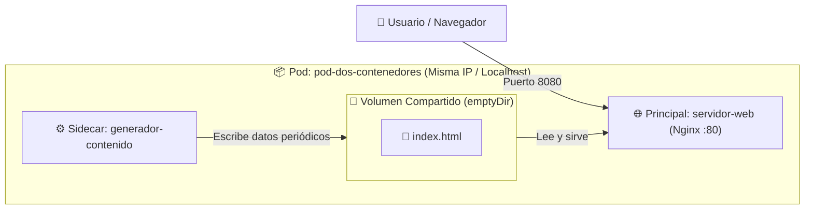

# 📂 Ejemplos Prácticos de Pods (Semana 1)

En esta carpeta encontrarás ejemplos progresivos de manifiestos YAML para comprender a fondo el comportamiento de los **Pods** en Kubernetes.

---

## 📑 Índice de Ejemplos

| Archivo | Tipo de Pod | Concepto Clave |
| :--- | :--- | :--- |
| [`01-mi-primer-pod.yaml`](./01-mi-primer-pod.yaml) | Pod Básico (1 Contenedor) | Estructura básica mínima de un Pod en Kubernetes. |
| [`02-pod-multi-contenedor.yaml`](./02-pod-multi-contenedor.yaml) | **Multi-Contenedor (2 Contenedores)** | Patrón Sidecar con volumen temporal compartido (`emptyDir`). |
| [`03-pod-con-recursos-y-env.yaml`](./03-pod-con-recursos-y-env.yaml) | Pod con Variables y Recursos | `requests`, `limits` de CPU/RAM y Downward API (`fieldRef`). |
| [`04-pod-con-init-container.yaml`](./04-pod-con-init-container.yaml) | Pod con `initContainers` | Tareas previas bloqueantes antes de iniciar la app principal. |
| [`05-pod-con-health-checks.yaml`](./05-pod-con-health-checks.yaml) | Pod con Sondas de Salud | `readinessProbe` y `livenessProbe` para auto-recuperación. |

---

## 🔍 Detalle del Pod con 2 Contenedores (Patrón Sidecar)

El archivo [`02-pod-multi-contenedor.yaml`](./02-pod-multi-contenedor.yaml) implementa un Pod con **dos contenedores** que colaboran estrechamente:

1. **`servidor-web` (Nginx):** Sirve tráfico HTTP en el puerto 80 desde la ruta `/usr/share/nginx/html`.
2. **`generador-contenido` (Busybox - Sidecar):** Ejecuta un bucle cada 5 segundos que actualiza un archivo `index.html` en la ruta `/datos`.



### ¿Qué comparten dos contenedores en el mismo Pod?
* **Red:** Comparten la misma dirección IP y el espacio de red. Pueden comunicarse entre sí usando `localhost:<puerto>`. (⚠️ **Ojo:** No pueden escuchar en el mismo puerto).
* **Almacenamiento:** Mediante volúmenes de tipo `emptyDir`, pueden leer y escribir en el mismo directorio del sistema de archivos.
* **Ciclo de vida:** Son programados juntos en el mismo Worker Node y mueren juntos.

---

## 🚀 Comandos Útiles para Interactuar

### 1. Aplicar los manifiestos
```bash
# Pod con 2 contenedores:
kubectl apply -f semana-01-arquitectura/1.ejemplos/02-pod-multi-contenedor.yaml
```

### 2. Ver el estado de los contenedores
Observa la columna `READY` (marcará `2/2` cuando ambos contenedores estén listos):
```bash
kubectl get pods
```

### 3. Ver logs de un contenedor específico
Cuando un Pod tiene más de un contenedor, debes especificar el contenedor con `-c`:
```bash
# Logs del servidor web:
kubectl logs pod-dos-contenedores -c servidor-web

# Logs o salida del contenedor generador:
kubectl logs pod-dos-contenedores -c generador-contenido
```

### 4. Entrar a la terminal de un contenedor específico
```bash
kubectl exec -it pod-dos-contenedores -c servidor-web -- sh
```

### 5. Probar el resultado en tu navegador
```bash
kubectl port-forward pod/pod-dos-contenedores 8080:80
```
Abre en tu navegador **[http://localhost:8080](http://localhost:8080)** y refresca cada pocos segundos para ver la fecha/hora actualizarse dinámicamente.
