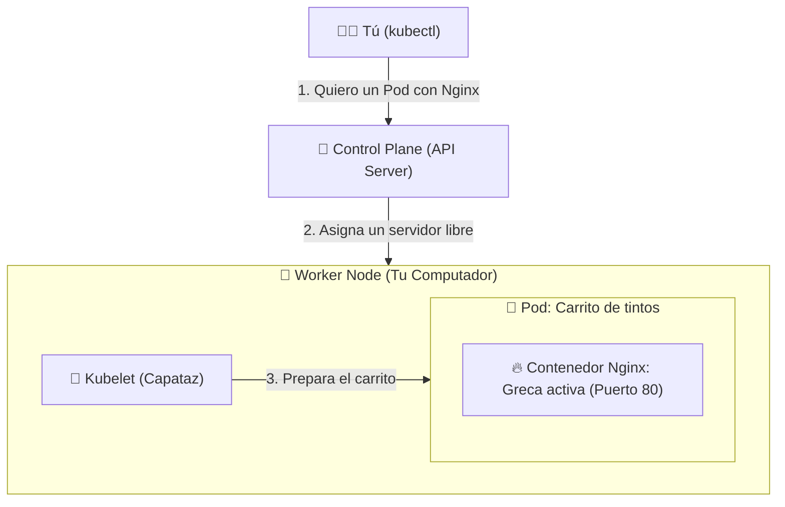

# 🌱 Semana 1: El motor por dentro y tu primer Pod

¡Bienvenido a la primera semana! Hoy pasaremos de entender qué hace Kubernetes en teoría a levantar nuestro propio clúster local y desplegar nuestra primera aplicación.

---

## 🧠 Resumen en 2 minutos (Sin enredos)

Imagina una red de carritos de tinto atendiendo en las estaciones del Metro de Medellín:
* **El Contenedor (Docker):** Es la **greca encendida** preparando el tinto (el proceso de tu aplicación corriendo en primer plano).
* **El Pod:** Es el **carrito de tintos**, donde va la greca montada junto con los vasitos desechables y el azúcar. En Kubernetes nunca pones grecas sueltas en el piso; siempre van agrupadas dentro de un **Pod** que les da red (IP) y almacenamiento compartido.
* **El Worker Node (Nodo trabajador):** Es la **estación física** (ej. Estación San Antonio o Parque Berrío) que cuenta con espacio y electricidad para alojar varios carritos.
* **El Control Plane (Cerebro):** Es la **administración central del Metro** que supervisa la operación completa, decide en qué estación poner cada carrito y envía reemplazos si alguno se daña.

👉 *¿Quieres ver la analogía completa con hora pico, Deployments, Services y HPA? Lee: [**De un Tinto Colombiano a Kubernetes**](../recursos/de-un-tinto-a-kubernetes.md).*



---

## 🧪 Laboratorio en Vivo (Hands-on)

> [!TIP]
> **¿Prefieres practicar en el navegador sin levantar un clúster local?**  
> Puedes realizar ejercicios interactivos guiados con terminal en la nube en [**KodeKloud Studio — Kubernetes Labs**](https://kodekloud.com/studio/labs/kubernetes).

### Paso 1: Crea tu clúster local
Si usas **Kind**, abre tu terminal y ejecuta:
```bash
kind create cluster --name cnm-lab
```
Verifica que tu clúster esté vivo:
```bash
kubectl cluster-info
kubectl get nodes
```

### Paso 2: Despliega tu primer Pod
Explora la carpeta [`1.ejemplos`](./1.ejemplos) y aplica el primer Pod básico en tu clúster:
```bash
kubectl apply -f semana-01-arquitectura/1.ejemplos/01-mi-primer-pod.yaml
```
*(También puedes probar un Pod multi-contenedor con dos contenedores usando `02-pod-multi-contenedor.yaml`)*


Revisa que esté corriendo (`Running`):
```bash
kubectl get pods
```

### Paso 3: Conéctate a tu Pod desde tu navegador
Usa `port-forward` para abrir un túnel desde tu computador hasta el Pod:
```bash
kubectl port-forward pod/hola-medellin 8080:80
```
👉 Abre en tu navegador **[http://localhost:8080](http://localhost:8080)** y verás tu servidor respondiendo.

### Paso 4: Visualiza tu clúster con la consola Open Source (Headlamp)
Para gestionar y entender mucho más rápido todo lo que pasa en tu clúster (nodos, pods, namespaces y eventos en tiempo real) sin depender exclusivamente de comandos en la terminal, te recomendamos usar **[Headlamp](https://headlamp.dev/)**, una consola visual open source moderna respaldada por Kubernetes SIGs.

Puedes utilizarla de tres formas según lo que prefieras:
1. **Como aplicación nativa de escritorio** (Windows, macOS o Linux, conectada a tu `~/.kube/config`).
2. **Dentro del clúster con Helm** (expuesta vía `NodePort` en `kube-system`).
3. **Como contenedor de Docker local**.

👉 **Sigue el tutorial paso a paso para instalarla en cualquiera de sus modalidades en:**  
🔗 [**Guía de Instalación y Uso de Headlamp (`headlamp.md`)**](./headlamp.md)

---

## 💥 El Reto Roto de la Semana 1

Entra a la carpeta [`reto-roto/pod-con-errores.yaml`](./reto-roto/pod-con-errores.yaml). Un compañero intentó desplegar un Pod pero cometió **2 errores muy comunes** y el Pod nunca pasa a estado `Running`.

### ¿Cómo superarlo?
1. Intenta aplicarlo en tu clúster: `kubectl apply -f semana-01-arquitectura/reto-roto/pod-con-errores.yaml`
2. Investiga qué le duele usando:
   * `kubectl get pods`
   * `kubectl describe pod pod-rebelde`
3. Copia el archivo a `aportes-comunidad/soluciones-retos/tu-usuario/semana-01/pod-solucionado.yaml`, corrígelo, agrega un comentario `#` explicando qué estaba mal y envía tu **Pull Request**.


## 🕵️‍♂️ Diccionario Rápido: ¿Qué le duele a mi Pod?

Cuando ejecutes `kubectl get pods`, el estado (`STATUS`) te dará la primera pista de dónde buscar:

| Estado del Pod | ¿Qué significa en español? | Comando para descubrir el culpable |
| :--- | :--- | :--- |
| **`Pending`** | El Pod está en la sala de espera. Ningún servidor tiene suficiente RAM/CPU libre para recibirlo. | `kubectl describe pod <nombre>` *(Mira la tabla de Events al final)*. |
| **`ImagePullBackOff`** o **`ErrImagePull`** | Kubernetes intentó descargar la imagen de Docker pero no existe, está mal escrita o es privada. | `kubectl describe pod <nombre>` *(Revisa qué imagen intentó bajar)*. |
| **`CrashLoopBackOff`** | El contenedor logró arrancar, pero la aplicación de adentro falló y se apagó sola. | `kubectl logs <nombre>` *(Lee el error que arrojó la aplicación)*. |
| **`Error de validación al hacer apply`** | El archivo YAML tiene un error de sintaxis, indentación o un nombre de campo inventado. | Lee el número de línea que te muestra la terminal al hacer `kubectl apply`. |